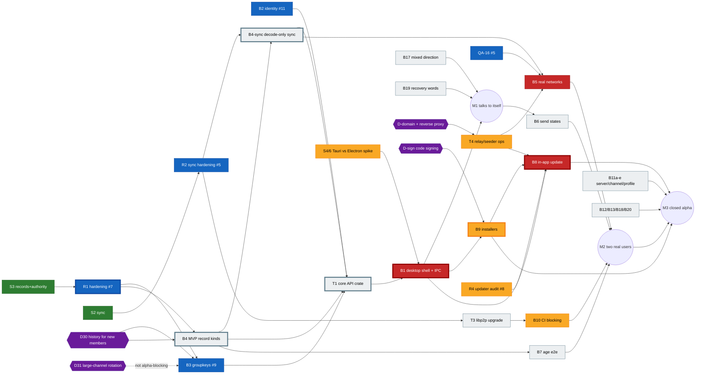

# MVS task board

The single source of truth for who does what, in which order, and what blocks the closed alpha.
Owner: project manager. Updated whenever a PR lands; if this board disagrees with a PR, a review or a chat, **the board wins until it is corrected here**.

Last updated: 2026-11-03, against `main` at `5ef10ff` (PRs #1–#4 merged) and open PRs #5–#13.

**Contents:** [Rules](#rules) · [Milestones](#milestones) · [Open PRs](#open-prs) · [Board](#board) · [Dependency map and critical path](#dependency-map-and-critical-path) · [Next assignments](#next-assignments) · [File ownership](#file-ownership) · [Risks and blockers](#risks-and-blockers) · [Owner decisions](#owner-decisions)

---

## Rules

- **Status:** `todo` · `in progress` · `in review` (PR open, waiting for a review or re-review) · `blocked` (named blocker) · `done` (merged to `main`).
- **Size:** S ≤ 1 PR of a day, M = 1–2 PRs, L = several PRs or a new crate.
- **Milestones:** M1, M2, M3 (below). `–` means after the closed alpha.
- **IDs** are the ones the source documents use, so they can be grepped: `B*` backlog (`docs/reviews/po-review-1.md`, PR #6), `UX-*` (`docs/reviews/ux-review-1.md`, PR #12), `QA-*` (`qa/BUGS.md`, PR #13), `U*` PO screenshot bugs, `ש-*` PO spec questions, `D*` owner decisions (spec decision log, line numbers), `R*` review findings and `S*` spikes (this board), `T*` new work items that only exist here.
- A PR merges only after the manager's review **and** a peer-agent `VERDICT: APPROVE`.
- Before starting an item, check [File ownership](#file-ownership). One writer per path at a time; anything else goes through the owner.
- Never commit IPs, keys, `.env` files or real tester data.

## Milestones

| | Name | Done when |
| --- | --- | --- |
| **M1** | Talks to itself | One desktop build runs the real Rust core behind the UI (no mock): create an identity from 12 words, create a server, post encrypted messages, restart and see them again. Two instances on one machine sync. |
| **M2** | Two real users chat | Two people on different machines and networks (incl. one behind NAT/CGNAT, via relay) join by link, chat with real send states, kick works and re-keys, offline catch-up works. B5 success criteria measured and committed. |
| **M3** | Closed alpha release | Signed (or documented-unsigned) installers for Windows, macOS, Linux from CI; in-app P2P update with rollback; relay + seeder running behind the owner's domain; P0 bugs closed; testers have instructions. |

## Open PRs

| PR | What | Author | Peer review | Status | Next step |
| --- | --- | --- | --- | --- | --- |
| [#5](https://github.com/moranmoa/MVP/pull/5) | sync hardening: verify blob ids, bound peer input, spike-peer relay timeout (QA-16) | dev-sync | CHANGES REQUESTED → fixed in `3bb79db` | in review | re-review |
| [#6](https://github.com/moranmoa/MVP/pull/6) | PO review 1 + backlog B1–B23 + spec decisions D27–D31 | po-review | APPROVE | in review | manager merge |
| [#7](https://github.com/moranmoa/MVP/pull/7) | records/authority security: bind servers to genesis, `mvs/` contexts | dev-records | CHANGES REQUESTED → fixed in `7f8f786` | in review | re-review (pending-queue flood R1) |
| [#8](https://github.com/moranmoa/MVP/pull/8) | updater audit + root rotation; CI ui job, pinned actions, npm licences; QA-14/15 | dev-updater | CHANGES REQUESTED | in progress | fix R4 (root-chain DoS) |
| [#9](https://github.com/moranmoa/MVP/pull/9) | groupkeys: per-channel epoch keys | dev-crypto | CHANGES REQUESTED → fixed in `1d0674c` | in review | re-review; recommendation for D30/D31 |
| [#10](https://github.com/moranmoa/MVP/pull/10) | UI security audit + phone layout | dev-ui | APPROVE | in review | manager merge |
| [#11](https://github.com/moranmoa/MVP/pull/11) | identity: 12 recovery words, keychain vault | dev-identity | CHANGES REQUESTED → fixed in `8422149` | in review | re-review |
| [#12](https://github.com/moranmoa/MVP/pull/12) | UX review 1 (UX-01..48) | ux-review | APPROVE | in review | manager merge |
| [#13](https://github.com/moranmoa/MVP/pull/13) | QA plan, Playwright smoke, bug list QA-01..16 | qa-tester | CHANGES REQUESTED | in progress | fix 6 PO findings (MSG-08, RES-01, OFF-04, AGE-07, wording, severities) |

**Merge order** (to keep `core/Cargo.toml` / `Cargo.lock` conflicts one-line): #6, #12, #10 (docs and UI, no core overlap) → #7 → #5 → #11 → #9 → #8 → #13. Each later core PR rebases and keeps every crate in `members`.

---

## Board

### Foundations (core crates)

| ID | Title | Owner | Status | PR | Depends on | Size | MS |
| --- | --- | --- | --- | --- | --- | --- | --- |
| S1 | Signed update chain (`core/updater`) | dev-updater | done | #1 | – | M | M3 |
| S2 | Log sync spike (`core/sync`) | dev-sync | done | #2 | – | M | M1 |
| S3 | Signed records + incremental authority | dev-records | done | #3 | – | M | M1 |
| R1 | Records/authority hardening: genesis binding, pending-queue flood, `mvs/` contexts | dev-records | in review | #7 | S3 | M | M1 |
| R2 | Sync hardening: canonical deps, bounded input, global pull limit | dev-sync | in review | #5 | S2 | M | M1 |
| B2 | Identity: 12 words, keychain, restore (+ QA-01 core side) | dev-identity | in review | #11 | – | S | M1 |
| B3 | Group encryption by epoch, re-key on kick | dev-crypto | in review | #9 | S3; D30, D31 for final shape | L | M1 |
| R4 | Updater audit: root-rotation chain DoS, QA-14, QA-15 | dev-updater | in progress | #8 | S1 | S | M3 |
| QA-16 | `spike-peer` hangs when relay is unreachable | dev-sync | in review | #5 | – | S | M2 |
| B4 | MVP record kinds (server edit/close, channels, invites + revoke, edit/delete tombstones, leave, age claim, kick-blocks-rejoin ש-4), revoke-only demotion (D28), `Kind::KeyRotation` ~48 KiB, `#general` auto-named (UX-04) | dev-records | todo | – | R1; D30 for history flag | L | M1 |
| B4-sync | Sync accepts only `Record::decode`d records; never forwards invalid/oversize ones; roles only from the signed log | dev-sync | todo | – | R2, B4 (kinds) | M | M1 |
| B23 | Name sanitising in core: bidi controls, invisible chars (QA-13, QA-06) | dev-records | todo | – | B4 | S | M2 |
| T1 | **Core API crate** (`core/api`): one Rust facade over identity + records + authority + sync + groupkeys that matches `ui/src/core/api.ts` (`CoreApi`) commands, events and error codes | dev-identity (lead), dev-crypto (crypto module) | todo | – | B2, R1, R2, B3, B4 (initial kinds) | L | M1 |
| T2 | Freeze all crypto domain strings as `mvs/…` (records, sync, groupkeys, identity, updater) and pin each with a test | each crate owner | in review | #5 #7 #8 #9 #11 | – | S | M1 |

### Shell, packaging, release

| ID | Title | Owner | Status | PR | Depends on | Size | MS |
| --- | --- | --- | --- | --- | --- | --- | --- |
| S4/6 | Spike 4+6: voice + footprint, **Tauri vs Electron** | dev-voice-shell | in progress | – | – | M | M1 |
| S5 | Spike 5: browser peer interop with native peers | dev-web | in progress | – | S2 | M | – |
| B1 | Desktop shell (per S4/6 decision) + real `CoreApi` over IPC; core in its own process; mock stays at `?demo` | dev-voice-shell | blocked (S4/6) | – | S4/6, T1 | L | M1 |
| B10 | CI: ui job (in #8), `qa/` smoke on every PR, libp2p upgrade, advisories blocking, `ring` exception permanent (D29) | dev-updater (CI), dev-sync (libp2p) | in progress | #8 | #13 for smoke; libp2p upgrade for blocking | S | M2 |
| T3 | libp2p 0.54 → current (clears `ring 0.16` advisories, rcgen, hickory) | dev-sync | todo | – | R2 merged | M | M2 |
| B9 | Installers: EXE/MSI, DMG (Intel + Apple Silicon), AppImage, deb, rpm in CI; third-party notices; SmartScreen/Gatekeeper tester notes | devops | in progress | – | B1; D-sign | M | M3 |
| B8 | In-app update: P2P + seeder, verify before install/forward, rail icon (UX-14), rollback after 3 failed starts, "what's new" from signed `notes` (ש-24) | dev-updater | blocked (B1) | – | R4, B1, B9, T4 | M | M3 |
| T4 | Relay + seeder + bootstrap in Docker on the owner's machine, public via reverse proxy and domain (D24); relay limits raised for catch-up | devops | in progress | – | D-domain | M | M2 |
| B5 | Real networks: 3 machines (home/cellular/work, 3 OSes), p95 < 1 s, creator leaves and others continue, offline catch-up via relay only, `spike-peer` ≥ 10 pairs ≥ 95 % (results committed, no IPs) | dev-sync + qa-tester | blocked (QA-16, T4) | – | QA-16, T4, B4-sync | M | M2 |
| B14 | UI performance in the real shell (incl. < 50 ms pending echo for B6) | dev-web | todo | – | B1 | M | M3 |
| B15 | Real diagnostics export from core | dev-identity | todo | – | T1 | S | M3 |

### Product features (UI + core)

| ID | Title | Owner | Status | PR | Depends on | Size | MS |
| --- | --- | --- | --- | --- | --- | --- | --- |
| B6 | Real send states: pending/sent/delivered (receipt ack ש-11), failed + retry; composer 16 KiB cap and no text loss (QA-10) | dev-sync (ack) + dev-ui (composer) | todo | – | B4-sync, T1; QA-10 part can start now | S | M2 |
| B7 | Age end-to-end: < 16 blocked, 120-year check (QA-04), signed age claims, 18+ channels hidden (ש-12), DOB correction rules, UX-15, UX-23 | dev-records (claims) + dev-ui | todo | – | B4 | M | M2 |
| B11a | Leave server (owner blocked, ש-19) | dev-ui | todo | – | B4 for core | S | M3 |
| B11b | Edit / close server (ש-22, ש-23) | dev-ui | todo | – | B4 | M | M3 |
| B11c | Channels: create, rename, delete (ש-20), 18+ flag | dev-ui | todo | – | B4 | M | M3 |
| B11d | Revoke invite + new link (ש-21) | dev-ui | todo | – | B4 | S | M3 |
| B11e | Edit profile: name, avatar, banner, bio (UX-02, UX-16, QA-02, QA-03) | dev-ui | todo | – | – (mock first) | S | M2 |
| B12 | Display bugs + 200 % / 24 px check (U1, U2, U4–U6, UX-05, UX-17, QA-12) | dev-ui | todo | – | #10 merged | M | M3 |
| B13 | Wording, product name MVS (`mvs://`, `app.name`, `document.title`), spec updates (ש-1, ש-2, ש-5, ש-8, ש-9), UX-39, UX-40 | po-review (spec + string table), dev-ui (i18n files) | todo | – | #6, #12 merged | S | M2 |
| B17 | Mixed-direction text in messages and strings (UX-01 blocker, UX-03, UX-18) | dev-ui | todo | – | #10 merged | S–M | M1 |
| B18 | P2P states in UI: own new server, offline server, background join (UX-07..09, QA-08) | dev-ui + dev-sync (API contract) | todo | – | T1 contract for background join | M | M2 |
| B19 | Recovery-words screen safety: resume after reload (QA-01), reading order, hidden by default (UX-05, UX-06, U1) | dev-ui | todo | – | B2 for persistence | S | M1 |
| B20 | Contrast AA (UX-13) | dev-ui | todo | – | – | S | M3 |
| B16 | Settings export/import, message density, date separators (UX-12) | dev-ui | todo | – | – | M | – |
| B21 | Accessibility + keyboard (UX-11, UX-20, UX-21, UX-34, UX-37, UX-38) | dev-ui | todo | – | – | M | – |
| B22 | Flow polish (UX-22..32 part, UX-41..48, QA-05, QA-07, QA-09, QA-11) | dev-ui | todo | – | – | M | – |
| UX-19 | Identity code shown on every message? | po-review | blocked (product call) | #12 | – | S | M3 |
| UX-10 | `mvs://` links not clickable in WhatsApp/Telegram/Discord → needs an https landing page on the owner's domain | devops + dev-ui | blocked (D-domain) | – | D-domain, T4 | S | M3 |

### Reviews, QA, security, business

| ID | Title | Owner | Status | PR | Depends on | Size | MS |
| --- | --- | --- | --- | --- | --- | --- | --- |
| PO-1 | PO review 1 + backlog | po-review | in review | #6 | – | M | M1 |
| UX-R1 | UX review 1 (48 findings, mapped into B12/B13/B17–B22) | ux-review | in review | #12 | – | M | M1 |
| QA-P1 | QA plan + Playwright smoke + bug list | qa-tester | in progress | #13 | – | M | M1 |
| T5 | Threat model across MVS (identity, records, sync, groupkeys, updater, relay, UI) | sec-lead | in progress | – | – | M | M2 |
| T6 | Go-to-market for the closed alpha: tester recruitment, owner-decision memos (domain, signing cost) | biz | in progress | – | – | M | M3 |
| T7 | QA on the real shell: rerun smoke + SC-01..SC-04 against B1 build | qa-tester | blocked (B1) | – | B1 | M | M2 |
| T8 | UX review 2 on the real shell (desktop, phone-width, 200 %) | ux-review | blocked (B1) | – | B1, B17, B12 | M | M3 |
| T9 | Alpha release checklist + go/no-go | manager + po-review | todo | – | M2 | S | M3 |

### Review findings (open)

| ID | Finding | PR | Owner | Status |
| --- | --- | --- | --- | --- |
| R1 | Anyone can fill authority's pending queue with orphans; out-of-order delivery stops (`incremental.rs:164`) | #7 | dev-records | fixed, awaiting re-review |
| R2 | Non-canonical deps: a stored blob is served back under a different id | #5 | dev-sync | fixed, awaiting re-review |
| R3 | A groupkeys rotation voided later by authority can't be withdrawn → peers diverge | #9 | dev-crypto | fixed (`set_voided`), awaiting re-review |
| R4 | Any peer can block root rotation → client frozen on old root (`root.rs:135-146`) | #8 | dev-updater | open |
| R5 | Keychain entry names not collision-safe / Windows roaming / recovery-check flag order | #11 | dev-identity | fixed, awaiting re-review |
| R6 | QA plan marks the UX-01 blocker as pass; RES-01, OFF-04, AGE-07 contradict ש-8, ש-9, ש-12 | #13 | qa-tester | open |
| R7 | `KeyRotation` doesn't fit a 16 KiB record above ~203 members | #9 → B4 | dev-records | todo (B4) |
| R8 | identity: macOS target build and real OS keychain not exercised in tests | #11 | dev-identity + devops | todo (needs macOS CI runner, B9) |

---

## Dependency map and critical path



Legend: green done · blue in review · yellow in progress · red blocked · grey todo · purple owner decision · thick border = critical path.

### Critical path to the closed alpha

```
R1 (#7) ─► B4 MVP record kinds ─► B4-sync ─► T1 core API crate ─► B1 desktop shell ─► B9 installers ─► B8 in-app update ─► M3
                ▲                               ▲      ▲                 ▲
          D30 decision                    B2 (#11)  B3 (#9)        S4/6 spike
```

- **Longest chain:** R1 → B4 (L) → B4-sync (M) → T1 (L) → B1 (L) → B9 (M) → B8 (M). Everything else (UI fixes, B11, B5 measurements, B10) runs in parallel and must just not fall behind it.
- **Gates on the path that are not code:** D30 (shapes B4's history flag and B3), S4/6 result (B1), D-domain (T4 → B5, B8), D-sign (B9).
- **Biggest lever:** start T1 as soon as #11 and #7 merge, against the B4 kinds that exist, and grow it as B4 lands. Do not wait for all of B4.
- **Parallel critical-ish path to M2:** T4 relay ops → B5 real-network run. T4 is waiting on the domain decision only.

---

## Next assignments

What each agent picks up **after its current PR merges** (or in parallel when noted), with the paths it may write. No two rows share a writable path at the same time.

| Agent | Now | Next (in order) | Writes | Must not touch |
| --- | --- | --- | --- | --- |
| **dev-records** | #7 (R1) | 1. **B4** MVP record kinds + revoke-only demotion (D28) + `Kind::KeyRotation` ~48 KiB (R7) + kick blocks rejoin (ש-4). 2. B7 age-claim records. 3. B23 name sanitising in core. | `core/records/**`, `core/authority/**` | `core/sync`, `core/groupkeys` |
| **dev-sync** | #5 (R2, QA-16) | 1. **B4-sync**: decode-only accept/forward, roles from log only. 2. Receipt ack for B6 (ש-11, protocol-level, not logged). 3. T3 libp2p upgrade. 4. Relay-only catch-up limits with devops, then B5 run with qa-tester. | `core/sync/**`, `core/spike-peer/**` | `core/records` (ask dev-records for kinds) |
| **dev-identity** | #11 (B2) | 1. **T1 core API crate** skeleton: `core/api` with identity + records + authority + sync wired, `CoreApi` command/event/error parity with `ui/src/core/api.ts`. 2. B15 diagnostics export. | `core/api/**` (new), `core/identity/**` | `ui/**` (contract changes go to dev-ui) |
| **dev-crypto** | #9 (B3) | 1. **Recommendation doc for D30 + D31** to the owner (in progress). 2. After T1 skeleton: the crypto module in T1 (encrypt Message bodies, apply rotations, `set_voided` fed from authority). 3. B3 acceptance: traffic-capture test (relay sees only ciphertext), 500-member rotation size. | `core/groupkeys/**`; `core/api/src/crypto/**` only after T1 skeleton merges | rest of `core/api` |
| **dev-voice-shell** | S4/6 spike | 1. Spike results + recommendation (decision log lines 1 and 7). 2. **B1** desktop shell + IPC `CoreApi` once T1 exposes commands. | `desktop/**` (new; or `ui/src-tauri/**` if Tauri), `ui/src/core/ipc.ts` (new file) | other `ui/src/**` (dev-ui), `ui/src/core/index.ts` — one-line `createCore()` switch done by dev-ui on request |
| **dev-web** | S5 spike | 1. Spike 5 results doc. 2. **B14** UI perf harness in the real shell (after B1). Until B1 lands: S5 follow-ups only (web is not on the alpha path). | `core/web-spike/**` (or its spike dir), later `perf/**` (new) | `ui/**`, `qa/**` |
| **dev-ui** | #10 | 1. **B17** mixed direction (UX-01 blocker). 2. **B19** recovery-words safety (QA-01, U1). 3. QA-10 composer cap. 4. B11e profile (mock). 5. B13 strings from PO's table. 6. B12, B20, B11a–d (mock first, core when B4/T1 land), B18. | `ui/**` (sole writer, incl. `ui/src/i18n/*.json`) | `ui/src/core/ipc.ts`, `desktop/**` |
| **dev-updater** | #8 (R4) | 1. Finish R4. 2. B10: `qa/` smoke job in CI (after #13), advisories blocking after T3. 3. **B8** in-app update after B1 + B9. | `core/updater/**`, `.github/workflows/ci.yml`, `.github/scripts/**`, `.github/dependabot.yml`, `core/deny.toml` | `.github/workflows/release.yml` (devops) |
| **devops** | installers + relay ops | 1. **T4** relay/seeder/bootstrap compose behind reverse proxy (as soon as D-domain lands; templated host, no IPs). 2. **B9** installer workflow — skeleton now on a hello-world Tauri/Electron app, real once B1 lands. 3. macOS runner for R8. | `infra/**`, `.github/workflows/release.yml` (new), `packaging/**` (new) | `.github/workflows/ci.yml` (dev-updater) |
| **qa-tester** | #13 (R6) | 1. Fix R6. 2. B5 run with dev-sync (QA-16 fixed in #5). 3. T7 rerun on the real shell. | `qa/**` | `ui/**` (bugs go to the board, fixes to dev-ui) |
| **po-review** | #6 | 1. **B13** spec updates (ש-1, ש-2, ש-5, ש-8, ש-9, D30/D31 once decided) + a ready-to-paste string table for dev-ui. 2. UX-19 decision proposal. 3. B4 acceptance check when it opens. | `docs/spec.md`, `docs/reviews/po-*` | `ui/src/i18n/*` |
| **ux-review** | #12 | 1. Review dev-ui's B17/B19 PRs visually. 2. Supply UX-39/40 wording to po-review's table. 3. T8 UX review 2 on the real shell. | `docs/reviews/ux-*` | `ui/**` |
| **sec-lead** | threat model (T5) | 1. Land T5 as `docs/security/threat-model.md`. 2. Second reviewer on B4, B4-sync and T1 (trust boundary between UI, core process and peers). 3. Sign-off on D-sign key custody (D23). | `docs/security/**` | crate code (findings go to owners) |
| **biz** | GTM (T6) | 1. Decision memos for D-domain and D-sign (costs, options). 2. Tester recruitment plan + alpha invite copy (with po-review). | `docs/business/**` | – |

### File-ownership conflicts to manage

| Path | Who wants it | Rule |
| --- | --- | --- |
| `core/Cargo.toml` `members`, `core/Cargo.lock` | #5, #7, #8, #9, #11, then T1, T3 | One-line conflict each time: **keep every crate**, regenerate the lock with `cargo update -w` and commit it. Follow the merge order above. T3 (libp2p) lands alone, not alongside T1's first PR. |
| `core/records/src/lib.rs` | #7 (dev-records), B4 (dev-records), R7 `KeyRotation` (asked by dev-crypto) | dev-records only. dev-crypto files the size requirement; does not edit records. |
| `core/authority/**` | #7, B4 (D28 revoke-only), T1 integration | dev-records only. T1 consumes the public API. |
| `core/spike-peer/src/main.rs` | #5 (QA-16 fix), B5 measurements | dev-sync only; qa-tester runs it, doesn't edit it. |
| `core/api/**` | dev-identity (skeleton), dev-crypto (crypto module), dev-sync (ack, background join) | dev-identity owns the crate; others add modules **after** the skeleton merges, each in its own submodule directory. |
| `ui/src/core/*` | dev-ui (types, mock), dev-voice-shell (IPC), T1 contract | `api.ts`/`types.ts`/`mock.ts`/`index.ts` = dev-ui. `ipc.ts` = dev-voice-shell. A contract change = PR by dev-ui first, IPC follows. |
| `ui/src/i18n/*.json` | dev-ui (new keys for B11), B13/UX-39/40 wording (PO, UX) | dev-ui is the only writer; PO/UX deliver a string table. |
| `.github/workflows/ci.yml` | #8 (dev-updater), B10 smoke (qa), B9 installers (devops) | dev-updater owns `ci.yml`; devops uses a separate `release.yml`; qa-tester asks dev-updater to add the smoke job. |
| `docs/spec.md` | #6 (PO), D30/D31 recommendation (dev-crypto), D-domain/D-sign (biz) | PO is the only writer of the spec; others write in their own docs and PO folds them in. |
| `infra/**` | devops (T4), dev-sync (relay limits) | devops only; dev-sync specifies limits in the B5 issue/notes. |

---

## Risks and blockers

| # | Risk / blocker | Impact | Mitigation | Owner |
| --- | --- | --- | --- | --- |
| K1 | **S4/6 Tauri vs Electron** undecided | B1, B9, B8, B14, T7, T8 all wait — biggest schedule risk | Timebox the spike; devops builds the installer pipeline skeleton on a hello-world of both meanwhile | dev-voice-shell, manager |
| K2 | **D30 history for new members** pending | B4 (history flag on server), B3 final behaviour, join UX copy | dev-crypto delivers the recommendation; B4 starts with the flag as a reserved field | owner, dev-crypto |
| K3 | **D31 large-channel rotation** pending | > ~200 members per kick costs > 16 KiB; not alpha-blocking | Alpha caps servers well below; `KeyRotation` ~48 KiB covers ~500 (R7) | owner, dev-crypto |
| K4 | **Domain + reverse proxy** (D24) undecided | T4 relay/seeder, B5 relay-only runs, B8 seeder, UX-10 https invite links | biz memo; devops keeps hostnames templated | owner, biz, devops |
| K5 | **Code signing** (Windows Authenticode, Apple Developer ID + notarisation) undecided | Without it testers hit SmartScreen/Gatekeeper; macOS keychain behaviour may differ unsigned (R8) | Decide sign vs documented-unsigned for closed alpha; B9 includes tester instructions either way | owner, biz, devops |
| K6 | T1 core API crate is new, large and unowned until now | Sits on the critical path between all core crates and the shell | Assign to dev-identity now; land a thin skeleton early; contract = existing `CoreApi` | manager |
| K7 | Many parallel core PRs touching `Cargo.toml`/`Cargo.lock` | Rebase churn, CI `--locked` failures | Fixed merge order; T3 libp2p upgrade alone | manager |
| K8 | libp2p 0.54 advisories (8 RustSec) | Advisories can't be blocking until upgraded (B10) | T3 after #5 | dev-sync |
| K9 | Real NAT/CGNAT never tested; relay circuit limits (2 min / 128 KiB) cut large catch-up | M2 success criterion | QA-16 fix (#5), raise relay limits in T4, B5 run with cellular | dev-sync, devops, qa-tester |
| K10 | UX-01 mixed-direction blocker in chat | Hebrew users see garbled messages — alpha-blocking | B17 first in dev-ui's queue | dev-ui |
| K11 | QA-01 recovery words lost on reload | Account can never create a server | B19 + B2 persistence | dev-ui, dev-identity |
| K12 | macOS untested for identity/keychain (R8) | Silent failure on 1 of 3 alpha OSes | macOS runner in CI | devops |

## Owner decisions

Decided (spec decision log, PR #6): D21 donations, D22 one recovery set, D23 one update key in closed alpha, **D24** helper servers in Docker on the owner's machine behind reverse proxy **with the owner's domain**, D25 LGPL dynamic OK, D26 gender-neutral Hebrew, **D27 name MVS** (`mvs/` crypto strings), **D28 demotion only via revoke**, **D29 `ring` licence exception permanent**.

Waiting:

| ID | Decision | Waiting on | Blocks | Needed by |
| --- | --- | --- | --- | --- |
| D30 | History for new members: per-server setting — encrypted with no pre-join history, or public unencrypted? | dev-crypto recommendation (PR #9 follow-up) | B4 history flag, B3 final shape, join copy (B13) | Before B4 merges (M1) |
| D31 | Key rotation in large channels (> ~200 members) | dev-crypto recommendation | Nothing for alpha; post-alpha scaling | Before open alpha |
| D-domain | Which domain, and the reverse proxy (Caddy/Traefik/nginx, TLS) for relay, seeder, bootstrap and invite landing page | biz memo | T4, B5, B8, UX-10 | Before M2 |
| D-sign | Code signing for closed alpha: buy Windows + Apple certificates now, or ship unsigned with instructions | biz memo (cost), sec-lead (key custody, D23) | B9, R8 | Before M3 |
| UX-19 | Show identity code on every message? | po-review proposal | B13 | M3 |
| ש-1..ש-24 | PO's recommended answers in PR #6 §7 (e.g. "נמסרה", "קוד זהות", English BIP39 words, re-ask DOB on restore) | owner confirms by merging #6 | B13, B6, B7, B2 restore flow | M2 |
