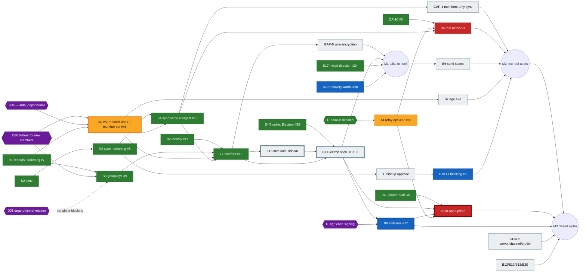

# MVS task board

The single source of truth for who does what, in which order, and what blocks the closed alpha.
Owner: pm (see [`docs/TEAM.md`](TEAM.md)). Updated whenever a PR lands; if this board disagrees with a PR, a review or a chat, **the board wins until it is corrected here**.

Last updated: 2026-11-03, refresh 5. `main` has PRs #1–#18, #22–#35, #46, #48–#60, #63. Open: #61, #62, #64–#66, plus Dependabot #36–#45, #47. **Owner decision 7: Electron** (spike #59, spec in #66).

**Contents:** [Rules](#rules) · [Milestones](#milestones) · [Open PRs](#open-prs) · [Board](#board) · [Dependency map and critical path](#dependency-map-and-critical-path) · [Next assignments](#next-assignments) · [File ownership](#file-ownership) · [Risks and blockers](#risks-and-blockers) · [Owner decisions](#owner-decisions)

---

## Rules

- **Owner column** uses the handles in [`docs/TEAM.md`](TEAM.md) (e.g. `tech-lead`, `dev-sync`, `product-lead`). `core-5` is an open core-developer slot.
- **Status:** `todo` · `in progress` · `in review` (PR open, waiting for a verdict) · `blocked` (named blocker) · `done` (merged to `main`).
- **Size:** S ≤ 1 PR of a day, M = 1–2 PRs, L = several PRs or a new crate.
- **Milestones:** M1, M2, M3 (below). `–` means after the closed alpha.
- **IDs** are the ones the source documents use, so they can be grepped: `B*` backlog (`docs/reviews/po-review-1.md`), `UX-*` (`docs/reviews/ux-review-1.md`), `QA-*` (`qa/BUGS.md`, PR #13), `U*` PO screenshot bugs, `ש-*` PO spec questions, `GAP-*` threat model (`docs/security/threat-model.md`, PR #15), `D*` owner decisions (spec decision log), `R*` review findings and `S*` spikes (this board), `T*` items that only exist here.
- **Review flow** ([TEAM.md](TEAM.md#review-flows)): engineering PRs need tech-lead (+ sec-lead for crypto, identity, permissions, network) → manager merges. A lead's own PR is reviewed by another lead.
- **Product review gate:** product, UX, business, QA-plan and board PRs need a `VERDICT: APPROVE` from product-lead. product-lead's own PRs are reviewed by ux (plus another lead). Engineering features are accepted or rejected by product-lead against their acceptance criteria before they are marked `done`.
- **Acceptance criteria:** B-items in `docs/reviews/po-review-1.md` §8; T-items in [T acceptance criteria](#t-acceptance-criteria) below.
- Before starting an item, check [File ownership](#file-ownership). One writer per path at a time.
- Never commit IPs, keys, `.env` files or real tester data.

## Milestones

| | Name | Done when |
| --- | --- | --- |
| **M1** | Talks to itself | One desktop build runs the real Rust core behind the UI (no mock): create an identity from 12 words, create a server, post encrypted messages, restart and see them again. Two instances on one machine sync. |
| **M2** | Two real users chat | Two people on different machines and networks (incl. one behind NAT/CGNAT, via relay) join by link, chat with real send states, kick works and re-keys, offline catch-up works. B5 success criteria measured and committed. Threat-model P0 gaps closed. |
| **M3** | Closed alpha release | Installers for Windows, macOS, Linux from CI (signed or documented-unsigned); in-app P2P update with rollback; relay + seeder running behind the owner's domain; P0 bugs closed; testers have instructions. |

## Open PRs

| PR | What | Author | Required verdicts | Status | Next step |
| --- | --- | --- | --- | --- | --- |
| [#61](https://github.com/moranmoa/MVP/pull/61) | **T4** relay ops part 1: circuit limits from env, relay-only discovery, seeder placeholder | devops | tech-lead, sec-lead (relay) | in review | verdicts pending |
| [#62](https://github.com/moranmoa/MVP/pull/62) | **B4-4** `check_channel` for channel records (GAP-2, GAP-5) | core-5 | tech-lead, sec-lead (permissions) | in review | sec-lead items addressed (`d323603`, `0d1a84e`); verdicts pending |
| [#64](https://github.com/moranmoa/MVP/pull/64) | **GAP-19** sync byte budget, per-IP cap, idle timeout, owner-only node key (+ T4 identify push) | dev-sync | tech-lead, sec-lead (network) | in review | verdicts pending; #65 adds Windows coverage |
| [#65](https://github.com/moranmoa/MVP/pull/65) | CI: Windows job also runs `sync` tests | dev-updater | tech-lead | in review | merges before or after #64 |
| [#66](https://github.com/moranmoa/MVP/pull/66) | spec: owner decision 7, **Electron** desktop shell | product-lead | another lead (product-lead's own PR) | in review | – |

Merged since the first board: #5–#18 (#18 = T1 `core/api`), #22 + #26 + #35 (UX specs), #23, #24 + #50 (B17), #25, #27 + #52 + #53 (QA re-tests), #28 (B19), #29 (S5), #30 (T4a), #32 (GAP-20), #33 + #48 (board), #34 + #60 (QA-10, QA-17), #46 + #58 (B4 stage 1, B4-1), #49 (CI smoke), #51 (GAP-8 groupkeys), #54 (B12), #55 (B4-sync), #56 (install test plan), #57 (crypto-incentives decision doc), #59 (S4/6), #63 (T12 package script).

**Merge order for core**: #62 (B4-4) and #64 (GAP-19) touch different crates and can merge in either order; #65 any time. Every later core PR rebases and keeps every crate in `members`. **Dependabot #36–#45, #47:** still on hold until #62 and #64 are in (K7). Crypto/identity majors (#37 argon2, #39 bip39, #42 curve25519-dalek, #36 rand, #44 rand_chacha) need sec-lead and can change derived keys or golden vectors, so take them one at a time; UI tool majors (#38 vite, #40 typescript, #43, #45, #47) go to dev-ui; #41 actions to dev-updater/devops.

---

## Board

### Foundations (core crates)

| ID | Title | Owner | Status | PR | Depends on | Size | MS |
| --- | --- | --- | --- | --- | --- | --- | --- |
| S1 | Signed update chain (`core/updater`) | dev-updater | done | #1 | – | M | M3 |
| S2 | Log sync spike (`core/sync`) | dev-sync | done | #2 | – | M | M1 |
| S3 | Signed records + incremental authority | tech-lead | done | #3 | – | M | M1 |
| R1 | Records/authority hardening: genesis binding, pending-queue flood, `mvs/` contexts | tech-lead | done | #7 | S3 | M | M1 |
| R2 | Sync hardening: canonical deps, bounded input, global pull limit | dev-sync | done | #5 | S2 | M | M1 |
| B2 | Identity: 12 words, keychain, restore (+ QA-01 core side) | dev-identity | done | #11 | – | S | M1 |
| B2-f | B2 follow-up from the approved B19 spec: `getRecoveryChallenge()`; `checkRecoveryWords` returns `{ ok }` or `{ ok: false, wrong }`, only for the challenge positions, capped at 5 failures | dev-identity | todo | – | #11 ✔, B19 spec ✔ (#22); sec-lead reviews the implementation | S | M1 |
| B3 | Group encryption by epoch, re-key on kick | dev-crypto | done | #9 | S3; D30 for final shape | L | M1 |
| R4 | Updater audit: root-rotation chain DoS, QA-14, QA-15 | dev-updater | done | #8 | S1 | S | M3 |
| QA-16 | `spike-peer` hangs when relay is unreachable | dev-sync | done | #5 | – | S | M2 |
| T2 | All crypto domain strings `mvs/…`, pinned by tests | each crate owner | done | #5 #7 #8 #9 #11 | – | S | M1 |
| B4 | MVP record kinds: server edit/close, channels, invite + revoke, **Join + member set (GAP-3; #18 borrows a control `Post` tagged `mvs/join/v1` until `Kind::Join` exists)**, edit/delete tombstones, leave, age claim, kick blocks rejoin (ש-4), **kick-undo (owner only) + the removed-members list behind `listRemovedMembers`**; revoke-only demotion (D28); `Kind::KeyRotation` 16 KiB per part, split into ≤ 32 parts (R7); **`auth_deps` format for channel messages (GAP-2)**; `#general` auto-named (UX-04) | core-5 (records-authority-dev-b4) | in progress (stage 1 #46 and B4-1 kind codes/formats #58 merged; B4-4 channel checks in #62) | #46 #58 #62 | R1 ✔; D30 for history flag; GAP-2 format decision by tech-lead + sec-lead | L | M1 |
| B4-sync | Verify records at ingest and before gossip forward (GAP-1, with T1); roles only from the signed log; **F1** answer pulls off the swarm task (`spawn_blocking` + read-only connection); **F3** dropped `Stored` events must surface (`Lagged` event or sequence number) so T1 re-reads the store | dev-sync | done (also direct connections + `/mvs/kad`) | #55 | R2, B4 kinds | M | M1 |
| F2 | Sync: filter dialled addresses, with a "LAN allowed" switch for the harness | dev-sync | todo | – | #5 | S | M2 |
| F4 | Sync: `make_room` scans all 4,096 buckets per new peer when full; switch to LRU if the limit grows | dev-sync | todo | – | #5 | S | – |
| GAP-4 | Answer sync only for members: peer-ID ↔ identity binding, secret-derived topic names | dev-sync | todo | – | B4 (member set), B4-sync | M | M2 |
| GAP-6 | Clients: Kademlia client mode, filter private addresses, `/mvs/kad/1.0.0` (relay side in T4a; ship together) | dev-sync | in progress (`/mvs/kad` client side in #55) | – | B4-sync | S | M2 |
| B23 | Name sanitising in core: bidi controls, invisible chars (QA-06; QA-13 fixed in the UI by #10, core-side check still needed) | core-5 | todo | – | B4 | S | M2 |
| T1 | **Integration crate `core/api`** — the single glue crate (no `core/node`; confirmed by tech-lead): wires sync → records → authority → groupkeys, verifies peer input (GAP-1 with B4-sync) and exposes the `CoreApi` facade matching `ui/src/core/api.ts` commands, events and error codes. First PR: identity, server create, roles, kick, age gate, SQLite, conformance fixtures; `Network` and `GroupCipher` are stand-in adapters until #5 and #9 land; messages answer `not-implemented`. **Parity also covers the spec additions:** `getRecoveryChallenge`, `leaveServer`, `updateServer`, `closeServer`, `createChannel`/`updateChannel`/`deleteChannel`, `revokeInvite`, `confirmJoin`, `listPendingJoins`, `cancelPendingMessage`, `listRemovedMembers`, `undoKick` | dev-identity (lead), dev-crypto (crypto module, GAP-5) | done | #18 | B2, R2, B3, B4 (initial kinds) | L | M1 |
| GAP-5 | Wire encryption into T1 in `core/api/src/crypto`: `Kind::KeyRotation`, `may_rotate`, feed `set_voided` from authority | dev-crypto | todo (unblocked: T1 #18, `KeyRotation` #58) | – | T1 skeleton, B4 (`KeyRotation`) | M | M1 |

### Shell, packaging, release

| ID | Title | Owner | Status | PR | Depends on | Size | MS |
| --- | --- | --- | --- | --- | --- | --- | --- |
| S4/6 | Spike 4+6: voice + footprint, **Tauri vs Electron** | dev-voice-shell | done: recommends **Electron**, owner decided (decision 7) | #59 | – | M | M1 |
| S5 | Spike 5: browser peer (rust-libp2p → WASM) joins the network | dev-web | done | #29 | S2 | M | – |
| B1 | Desktop shell, **Electron** (decision 7), in small PRs: **B1-1** secure skeleton; **B1-2** bridge to the `mvs-core` sidecar (T13), real `CoreApi` over IPC, minimal IPC surface (GAP-17); **B1-3** packaging: NSIS per-user with keep/delete data, AppImage/.deb (feeds B9, T12). Mock stays at `?demo` | dev-voice-shell | todo (unblocked) | – | T1 ✔, S4/6 ✔; B1-2 needs T13 | L | M1 |
| T13 | `mvs-core` sidecar binary in `core/api`: runs the core in its own process for the Electron shell (decision 7) | dev-identity | todo | – | T1 ✔ | M | M1 |
| B10 | CI: ui job (#8), `qa/` smoke on every PR (#49), Electron version-age check (decision 7), advisories blocking, `ring` exception permanent (D29) | dev-updater | in progress (ui job #8 and smoke #49 merged) | #8 #49 | #13 for smoke; T3 for blocking | S | M2 |
| T3 | libp2p 0.54 → current (clears `ring 0.16` advisories, rcgen, hickory) | dev-sync | todo | – | #5 merged | M | M2 |
| B9 | Installers: release workflow + archives + `SHA256SUMS` + unsigned manifest body (in #17); then EXE/MSI, DMG, AppImage/deb/rpm via the shell plug-in point (`MVS_SHELL=electron` in `release.yml`, packages from B1-3); third-party notices; SmartScreen/Gatekeeper notes | devops | in progress (pipeline merged in #17; packaging skeleton next, final packaging blocked on B1) | #17 | B1; D-sign | M | M3 |
| T4a | **P0 before alpha**, relay hardening from the #17 review: relay R7 `Cargo.lock` + `--locked` + images pinned by digest; R3 connection + memory limits; R6 `node.key` 0600, refuse otherwise; R1/R2 global-address filter + `/mvs/kad/1.0.0` (with dev-sync, GAP-6); R10 identify string `/mvs/0.1.0`; `v*` tag protection | devops | done | #30 | #17 | S | M2 |
| T4 | Relay + seeder + bootstrap in Docker on the owner's machine behind Caddy and `<relay-domain>` (D24, 5.1); relay limits raised for catch-up; stop logging who talks to whom (GAP-7, closed in #17); no connection logs on disk at the relay or bootstrap, only in-memory metadata and aggregate counters (product-lead, #16) | devops | in progress (ops part 1 in #61) | #17 #61 | D-domain for go-live | M | M2 |
| B8 | In-app update: P2P + seeder, verify before install/forward, rail icon (UX-14), rollback after 3 failed starts, "what's new" from signed `notes` (ש-24) | dev-updater | blocked (B1) | – | R4, B1, B9, T4 | M | M3 |
| B5 | Real networks: 3 machines (home/cellular/work, 3 OSes), p95 < 1 s, creator leaves and others continue, offline catch-up via relay only, `spike-peer` ≥ 10 pairs ≥ 95 % (results committed, no IPs) | dev-sync + qa | blocked (T4 go-live) | – | QA-16, T4, B4-sync | M | M2 |
| B14 | UI performance in the real shell (incl. < 50 ms pending echo for B6) | dev-web | todo | – | B1 | M | M3 |
| B15 | Real diagnostics export from core | dev-identity | todo | – | T1 | S | M3 |

### Product features (UI + core)

| ID | Title | Owner | Status | PR | Depends on | Size | MS |
| --- | --- | --- | --- | --- | --- | --- | --- |
| B6 | Real send states: pending/sent/delivered (receipt ack ש-11), failed + retry; composer cap and no text loss (QA-10); **QA-17** (product-lead decision): one limit of **4,000 code points** in composer, display, sanitizer and core; counter shown from 3,800; fits under the 16 KiB record limit | dev-sync (ack) + dev-ui (composer) | in progress (composer done: QA-10 #34, code-point count QA-17 #60; receipt ack left) | #34 #60 | B4-sync, T1; QA-10 part can start now | S | M2 |
| B7 | Age end-to-end: < 16 blocked, 120-year check (QA-04), signed age claims, 18+ channels hidden (ש-12), DOB correction rules, UX-15, UX-23 | core-5 (claims) + dev-ui | todo (spec in #35) | – | B4 | M | M2 |
| B11a | Leave server (owner blocked, ש-19) | dev-ui | todo (spec approved) | spec #26 | B4 for core | S | M3 |
| B11b | Edit / close server (ש-22, ש-23) | dev-ui | todo (spec approved) | spec #26 | B4 | M | M3 |
| B11c | Channels: create, rename, delete (ש-20), 18+ flag | dev-ui | todo (spec approved) | spec #26 | B4 | M | M3 |
| B11d | Revoke invite + new link (ש-21) | dev-ui | todo (spec approved) | spec #26 | B4 | S | M3 |
| B11e | Edit profile: name, avatar, banner, bio (UX-02, UX-16, QA-02; QA-03 fixed by #10) | dev-ui | todo (spec approved) | spec #26 | – (mock first) | S | M2 |
| B12 | Display bugs + 200 % / 24 px check (U1, U2, U4–U6, UX-05, UX-17, QA-12, **now High**: at 200 % + 24 px on 1366×768 the member list collapses below ~900 effective px and the channel list moves to a drawer below ~700); **QA-18 (Medium; passes on #28, closes as a regression check)**: at 375 px the recovery-word check step is 516 px wide and "בדיקה" is off-screen (same root as UX-05; do it with B19); **QA-19** (Low): reply reference tap target ~19 px, goal ≥ 44 px | dev-ui | done (product-lead acceptance pending) | #54 | – | M | M3 |
| B13 | Wording, product name MVS (`mvs://`, `app.name`, `document.title`), spec updates (ש-1, ש-2, ש-5, ש-8, ש-9), UX-39, UX-40 | product-lead (spec + string table), dev-ui (i18n files) | todo | – | – | S | M2 |
| B17 | Mixed-direction text in messages and strings (UX-01 blocker, UX-03, UX-18), built from `docs/ux/specs/B17-mixed-direction.md` (spec approved). Includes **UX-19** on the same message-head line: identity code next to the name, 0.75rem, `--text-muted`, `aria-hidden` on the code, `aria-labelledby` on the article | dev-ui | done, accepted | #24 #50 (spec #22) | – | S–M | M1 |
| B18 | P2P states in UI: own new server, offline server, background join (UX-07..09, QA-08) | dev-ui + dev-sync (API contract) | todo (spec approved) | spec #26 | T1 contract for background join | M | M2 |
| B19 | Recovery-words screen safety: resume after reload (QA-01), reading order, hidden by default (UX-05, UX-06, U1), recovery challenge | dev-ui | merged, **not accepted**: lock after 5 failures, one column at 200 %, screenshots 82 and 84–87 missing (QA-01, QA-18 pass) | #28 (spec #22) | B2-f for the core side | S | M1 |
| B20 | Contrast AA (UX-13) | dev-ui | todo | – | – | S | M3 |
| B16 | Settings export/import, message density, date separators (UX-12) | dev-ui | todo | – | – | M | – |
| B21 | Accessibility + keyboard (UX-11, UX-20, UX-21, UX-34, UX-37, UX-38) | dev-ui | todo | – | – | M | – |
| B22 | Flow polish (UX-22..32 part, UX-41..48, QA-05, QA-07, QA-09, QA-11) | dev-ui | todo | – | – | M | – |
| B24 | About screen: abuse-report address, links to the agreement and privacy notice (business plan §3.3, approved by product-lead in #16) | dev-ui | todo (5.1 decided; spec in #35) | – | 5.1 | S | M3 |
| UX-10 | `mvs://` links not clickable in WhatsApp/Telegram/Discord → https landing page on `<relay-domain>` | devops + dev-ui | todo (5.1 decided) | – | T4 | S | M3 |

### Reviews, QA, security, business

| ID | Title | Owner | Status | PR | Depends on | Size | MS |
| --- | --- | --- | --- | --- | --- | --- | --- |
| PO-1 | PO review 1 + backlog B1–B23 | product-lead | done | #6 | – | M | M1 |
| UX-R1 | UX review 1 (48 findings, mapped into B12/B13/B17–B22) | ux | done | #12 | – | M | M1 |
| UI-SEC | UI security audit + phone layout | dev-ui | done | #10 | – | M | M1 |
| QA-P1 | QA plan + Playwright smoke + bug list | qa | done | #13 | – | M | M1 |
| QA-R1 | QA re-test 1: QA-17..19 new, QA-03/13 closed | qa | done | #27 | – | S | M1 |
| T11 | UX specs before build: B17, B19, B11e, B18, B11a–d, B7, B24 in `docs/ux/specs/` | ux | done | #22, #26, #35 | – | M | M1–M3 |
| T12 | Install/uninstall verification (owner requirement) on Windows and Linux (+ macOS): update, keep/delete data, keychain never deleted silently, reinstall + restore, per-user without admin. `docs/release/INSTALL-TESTS.md` + `.github/workflows/install-tests.yml`; qa plan INS-01..16 (#56); manual pass by qa; feeds B1-3 | devops (+ dev-voice-shell packages, qa) | todo (plan #56, package script #63 merged) | #56 #63 | T4, B1-3 | M | M3 |
| T5 | Threat model, relay review, PR checklist | sec-lead | done | #15 | – | M | M2 |
| T6 | Business plan 1: alpha recruitment, costs, legal drafts, owner decisions §5 | biz | done | #16 | – | M | M3 |
| T10 | Team structure + review flows (`docs/TEAM.md`) | pm | done | #14 | – | S | M1 |
| T7 | QA on the real shell: rerun smoke + SC-01..SC-04 against the B1 build | qa | blocked (B1) | – | B1 | M | M2 |
| T8 | UX review 2 on the real shell (desktop, phone-width, 200 %) | ux | blocked (B1) | – | B1, B17, B12 | M | M3 |
| T9 | Alpha release checklist + go/no-go | manager + product-lead | todo | – | M2 | S | M3 |

### Review findings (open)

| ID | Finding | PR | Owner | Status |
| --- | --- | --- | --- | --- |
| R7 | `KeyRotation` doesn't fit a 16 KiB record above ~203 members | #9 → B4 | core-5 | todo (B4) |
| R8 | identity: macOS build and real OS keychain not exercised in tests | #11 | dev-identity + devops | todo (macOS runner) |
| GAP-1..7, GAP-17 | Threat-model P0 gaps: no ingest verification, no `auth_deps`, no member set, sync answers anyone, no wire encryption, DHT leaks IPs, relay logs pairs, IPC surface | #15 | GAP-1 → B4-sync + T1; GAP-2/3/5 records side → B4; GAP-4 and GAP-6 clients → dev-sync after B4-sync; GAP-6 relay → T4a; GAP-7 closed in #17; GAP-5 encryption → dev-crypto; GAP-17 → dev-voice-shell + dev-identity (B1) | in progress (GAP-1 done #55, GAP-3 #46, GAP-7 #17, GAP-20 #32, GAP-8 #51; GAP-2/5 in #62, GAP-19 in #64) |

Closed since the first board: R1 (#7), R2 (#5), R5 (#11), R6 (#13); R3 and R4 approved in #9 and #8.

### T acceptance criteria

B-items: `docs/reviews/po-review-1.md` §8. T2 and T5–T8 are as written in their rows.

| ID | Acceptance criteria |
| --- | --- |
| T1 | The crate exposes every command and event in `ui/src/core/api.ts`, with the same names, the JSON shapes from `types.ts` and the same error codes; a parity test fails if `api.ts` and the crate disagree. Every call is async and answers from the local store, without waiting on the network. An integration test covers M1: create an identity, create a server, send a message, restart and see it again; two instances on one machine sync. Peer input reaches T1 only through `Record::decode`, and a malformed-input test proves there's no panic. The UI contract tests pass against both the mock and T1. |
| T3 | libp2p is upgraded and all tests are green; `ring 0.16` and `rcgen 0.11` are gone from `Cargo.lock`; the advisories job is clean, or each remaining advisory is listed with a reason. |
| T4 | One compose file runs relay, seeder and bootstrap, with a templated hostname and no IPs in git. TLS comes from the reverse proxy, which forwards only WebSocket; TCP/UDP ports are documented. Relay circuit limits are raised so 10,000 missed messages catch up over a relay-only path, measured. Restart policies and a health check are in place. No connection logs on disk at the relay or bootstrap; only in-memory metadata and aggregate counters. |
| T9 | The go/no-go checklist covers the spec's Definition of Done, M3 "done when", all Blocker/High bugs closed, SC-01..04 results committed, and tester instructions (install, unsigned-build warnings if relevant, how to export diagnostics). |
| T11 | Each spec has RTL and LTR layouts, all states, exact Hebrew and English strings, keyboard and screen-reader behaviour, and acceptance checks; product-lead approves it before dev-ui starts the item (B17 may start from UX-01 now). |

---

## Dependency map and critical path



Legend: green done · blue in review · yellow in progress · red blocked · grey todo · purple decision · thick border = critical path.

### Critical path to the closed alpha

```
T13 mvs-core sidecar ─► B1 Electron shell (B1-1 ─► B1-2 ─► B1-3) ─► B9 installers ─► B8 in-app update ─► M3
        ▲                         ▲                     ▲
   T1 ✔ (#18)          S4/6 ✔ Electron (#59)      D-sign, T12
```

- **Longest chain:** T13 (M) → B1 (L) → B9 (M) → B8 (M). T1, B4-sync, B4 stage 1 and the shell decision are done, so **T13 is now the head of the path**; B1-1 (skeleton) can start in parallel with it.
- **Non-code gates on the path:** D-sign (B9). D-domain and decision 7 are decided. D30 still gates the B4 history flag, off the path.
- **Biggest lever:** dev-identity on T13 first; dev-voice-shell on B1-1 now so B1-2 can start the day T13 lands.
- **Parallel path to M2:** T4 relay ops (#61) → go-live → B5 real-network run; GAP-4 members-only sync; GAP-5 wire encryption; rest of B4 (#62).

---

## Next assignments

What each agent picks up **after its current PR merges**, the lead who assigns it, and the paths it may write. No two rows share a writable path at the same time.

| Agent | Assigned by | Now | Next (in order) | Writes | Must not touch |
| --- | --- | --- | --- | --- | --- |
| **core-5** (records-authority-dev-b4) | tech-lead → core sub-lead | #62 (B4-4) | 1. Land #62. 2. Rest of B4 (kick-undo + removed-members list, `#general`, D28 demotion). 3. B7 age-claim records. 4. B23 core name sanitising. | `core/records/**`, `core/authority/**` | `core/sync`, `core/groupkeys`, `core/api` |
| **tech-lead** | manager | reviews #61, #62, #64, #65, #66 (as the second lead) | 1. Review B1-1..3 and T13 as they land. 2. Dependabot order after #62/#64. | – (`core/records` + `core/authority` handed to core-5) | – |
| **dev-sync** | tech-lead → dev-identity | #64 (GAP-19) | 1. Land #64. 2. GAP-6 rest (client mode, private-address filter) + F2. 3. GAP-4 members-only sync. 4. Receipt ack for B6 (ש-11). 5. T3 libp2p upgrade (alone, see conflicts). 6. B5 run with qa after T4 go-live. F4 when the peer limit grows. | `core/sync/**`, `core/spike-peer/**` | `core/records`, `infra/` |
| **dev-identity** (core sub-lead) | tech-lead | – (#18 merged) | 1. **T13** `mvs-core` sidecar (critical path, B1-2 waits on it). 2. **B2-f** recovery challenge + 5-failure cap (B19 acceptance needs it). 3. GAP-17 IPC surface with dev-voice-shell. 4. B15 diagnostics. | `core/api/**`, `core/identity/**` | `ui/**` (contract changes go to dev-ui) |
| **dev-crypto** | tech-lead → dev-identity | – (#9 merged) | 1. **GAP-5** crypto module in `core/api/src/crypto/` (now unblocked). 2. D30 + D31 recommendation to the owner. 3. B3 acceptance: relay sees only ciphertext; 500-member rotation size. | `core/groupkeys/**`; T1 `src/crypto/**` after skeleton | rest of T1 crate, `core/records` |
| **dev-updater** | tech-lead → dev-identity | #65 | 1. Land #65. 2. B10: Electron version-age check in CI; advisories blocking after T3. 2. **B8** in-app update after B1 + B9. | `core/updater/**`, `.github/workflows/ci.yml`, `.github/scripts/npm-licenses.mjs`, `.github/scripts/install-cargo-deny.sh`, `.github/dependabot.yml`, `core/deny.toml` | `release.yml`, `.github/scripts/manifest-body.mjs` |
| **dev-voice-shell** | tech-lead → dev-ui | – (#59, #63 merged) | 1. **B1-1** Electron secure skeleton. 2. **B1-2** sidecar bridge + `ipc.ts` (after T13). 3. **B1-3** packaging (NSIS per-user keep/delete data, AppImage/.deb) with devops; T12 packages. | `desktop/**` (new), `ui/src/core/ipc.ts` (new) | other `ui/src/**`, `release.yml` (send devops a patch) |
| **dev-web** | tech-lead → dev-ui | – (#29 merged) | 1. **B14** UI perf harness in the real shell (after B1). | spike dir, later `perf/**` (new) | `ui/**`, `qa/**` |
| **dev-ui** (client sub-lead) | tech-lead | – (#28, #34, #50, #54, #60 merged) | 1. **B19 follow-up** for acceptance: lock after 5 failures (with B2-f), one column at 200 %, screenshots 82 and 84–87. 2. B12 acceptance fixes if product-lead asks (QA-12 High), then B20. 3. B24 from the #35 spec; B7 once B4 age claims land. 4. B11e, B18, B11a–d from the approved specs (#26), mock first. 5. B13 strings. 6. UX-10 link handling. | `ui/**` (sole writer, incl. `ui/src/i18n/*.json`) | `ui/src/core/ipc.ts`, `desktop/**` |
| **devops** | tech-lead | #61 (T4) | 1. Land #61, then **T4** go-live on `<relay-domain>` (never commit the real name). 2. **T12** install tests. 3. **B9**: `MVS_SHELL=electron` in `release.yml`. 3. macOS runner for R8. 5. UX-10 landing page with dev-ui. | `infra/**`, `.github/workflows/release.yml`, `.github/scripts/manifest-body.mjs`, `docs/release/**`, `packaging/**` (new) | `ci.yml` (dev-updater) |
| **sec-lead** | manager | – (#15 merged) | 1. Verdicts on #61 (relay), #62 (permissions), #64 (network). 2. Crypto Dependabot majors one at a time. 3. Review B2-f, GAP-5, T13 and B1-2 (IPC surface, GAP-17) (`PR-CHECKLIST.md`). 4. Key custody for D-sign / D23. | `docs/security/**` | crate code (findings go to owners) |
| **qa** | manager | – (#27 merged) | 1. Re-test QA-17 after #60; B19 follow-up. 2. T12 manual install pass (INS-01..16). 3. B5 run with dev-sync. 4. T7 rerun on the real shell. | `qa/**` | `ui/**`, `ci.yml` (ask dev-updater) |
| **product-lead** | manager | – | 1. **B13**: spec updates + string table. 2. Acceptance of B12 (#54) and the B19 follow-up. 3. Review of product/UX/business/QA/board PRs. | `docs/spec.md`, `docs/reviews/po-*` | `ui/src/i18n/*` |
| **ux** | product-lead | – (#22, #26, #35 merged) | 1. Visual check of dev-ui PRs against the specs (B19 follow-up, B12). 2. T8 after B1. | `docs/ux/**`, `docs/reviews/ux-*` | `ui/**` |
| **biz** | product-lead | – (#16 merged) | 1. Answer the owner's questions on §5 (5.1–5.13). 2. Tester recruitment wave 1 with product-lead. | `docs/business/**` | – |
| **pm** | manager | this PR | Batched board refreshes; flag conflicts. | `docs/BOARD.md`, `docs/TEAM.md` | everything else |

### File-ownership conflicts to manage

| Path | Who wants it | Rule |
| --- | --- | --- |
| `core/Cargo.toml` `members`, `core/Cargo.lock` | #5, #8, #9, #11, then T1, T3 | One-line conflict each time: **keep every crate**, regenerate the lock and commit it. Follow the merge order. T3 (libp2p) lands alone, not with T1's first PR. |
| `core/records/**`, `core/authority/**` | B4, B7 claims, B23 (core-5), R7 `KeyRotation` (dev-crypto), GAP-2/3 (sec-lead), kick-undo (product-lead) | core-5 (records-authority-dev-b4) only. Others file requirements; they don't edit. |
| T1 crate `core/api/**` | dev-identity (#18), dev-crypto (GAP-5), dev-sync (ack, background join, ingest checks) | `core/api` is the single glue crate (tech-lead). dev-identity owns it; others add modules in their own subdirectory after #18 merges. |
| `core/spike-peer/src/main.rs` | #5 (QA-16), B5 | dev-sync only; qa runs it. |
| `ui/src/core/*` | dev-ui (types, mock), dev-voice-shell (IPC), T1 contract | `api.ts`/`types.ts`/`mock.ts`/`index.ts` = dev-ui; `ipc.ts` = dev-voice-shell. A contract change is a dev-ui PR first; IPC follows. |
| `ui/src/i18n/*.json` | dev-ui, B13/UX-39/40 (product-lead, ux) | dev-ui is the only writer; product-lead/ux deliver a string table. |
| `.github/workflows/ci.yml` | #8 (dev-updater), B10 smoke (qa) | dev-updater only. |
| `.github/workflows/release.yml` | #17 (devops), B1 shell packaging (dev-voice-shell), B8 updater payload (dev-updater) | devops only; others send the step as a patch or PR comment. |
| `.github/scripts/**` | #8 (`npm-licenses.mjs`, `install-cargo-deny.sh`), #17 (`manifest-body.mjs`) | Split per file as in the table above. |
| `docs/spec.md` | product-lead; inputs from dev-crypto (D30/D31), sec-lead (GAPs), biz (§5) | product-lead only. |
| `infra/**`, `.gitignore` | devops (#17), dev-sync (relay limits) | devops only; dev-sync specifies limits. `.gitignore` changes go through devops. |

---

## Risks and blockers

| # | Risk / blocker | Impact | Mitigation | Owner |
| --- | --- | --- | --- | --- |
| K1 | ~~S4/6 Tauri vs Electron~~ **closed**: owner decision 7 = Electron (#59, #66). Tauri's Linux webview has no WebRTC; native voice engine stays an option for later | B1, B9, B8, B14, T7, T8 now unblocked on the shell | B1 in small PRs (B1-1..3); T13 sidecar is the new critical-path step | dev-voice-shell, dev-identity |
| K2 | **D30 history for new members** pending | B4 history flag, B3 final behaviour, join copy | dev-crypto recommendation; B4 reserves the field | owner, dev-crypto |
| K3 | **D31 large-channel rotation** pending | > ~200 members per kick > 16 KiB; not alpha-blocking | Alpha caps servers below; `KeyRotation` ~48 KiB covers ~500 (R7) | owner, dev-crypto |
| K4 | Domain decided (5.1, private: written `<relay-domain>` everywhere in git) | T4 go-live, B5, B8, UX-10 now unblocked on the domain | Never commit the real name; `infra/.env.example` stays templated | devops |
| K5 | **Code signing** undecided | SmartScreen/Gatekeeper friction; macOS keychain may differ unsigned (R8) | Awaiting owner on 5.7 + 5.8 (biz recommends unsigned closed alpha); #17 already ships unsigned archives + offline manifest signing | owner, biz, devops |
| K6 | **Threat-model P0 gaps** (GAP-1..7): crates are solid alone, nothing wires them | M2 security bar; an outsider can read/flood a server today | Gaps mapped to B4, B4-sync, GAP-4/5/6, T4, B1; sec-lead reviews each | tech-lead, sec-lead |
| K7 | Many parallel core PRs touching `Cargo.toml`/`Cargo.lock` | Rebase churn, CI `--locked` failures | Fixed merge order; T3 alone | pm, manager |
| K8 | libp2p 0.54 advisories (8 RustSec) | Advisories can't be blocking (B10) | T3 after #5 | dev-sync |
| K9 | Real NAT/CGNAT never tested; relay circuit limits cut large catch-up | M2 success criterion | QA-16 (#5), relay limits in T4, B5 with cellular | dev-sync, devops, qa |
| K10 | UX-01 mixed-direction blocker in chat | Hebrew users see garbled messages | B17 first for dev-ui | dev-ui |
| K11 | QA-01 recovery words lost on reload | Account can never create a server | B19 + B2 persistence | dev-ui, dev-identity |
| K12 | macOS untested for identity/keychain (R8) | Silent failure on 1 of 3 alpha OSes | macOS runner | devops |
| K13 | Critical path now runs through T13 (sidecar) and B1 | T13 or B1 slips → B9, B8, T12 and M3 slip | T1, B4-sync and B4 stage 1 are merged; dev-identity takes T13 first | tech-lead |
| K14 | Review load on tech-lead + sec-lead (5 PRs + 11 Dependabot open now) | Merge queue stalls | Sub-leads pre-review; follow the merge order; docs PRs go to product-lead | tech-lead, sec-lead |

## Owner decisions

Decided (spec decision log): **decision 7: Electron desktop shell** (#59, #66), D21 donations, D22 one recovery set, D23 one update key in closed alpha, **D24** helper servers in Docker on the owner's machine behind a reverse proxy with the owner's domain, D25 LGPL dynamic OK, D26 gender-neutral Hebrew, **D27 name MVS** (`mvs/` crypto strings), **D28 demotion only via revoke**, **D29 `ring` licence exception permanent**.

Also decided: **ש-1..ש-24**, the spec answers in `docs/reviews/po-review-1.md` §7, merged with #6. For example "נמסרה", "קוד זהות", English BIP39 words, DOB asked again on restore, kick blocks rejoin, 18+ channels hidden. ש-15 and ש-18 remain open as D30/D31. **UX-19** was decided by product-lead: the identity code stays next to every name, muted (folded into B12).

Waiting:

| ID | Decision | Waiting on | Blocks | Needed by |
| --- | --- | --- | --- | --- |
All rows below are **awaiting owner**: the recommendations are written, and the owner's answer is the only thing missing. Recommendations are in `docs/business/plan-1.md` §5 and in dev-crypto's groupkeys recommendation.

| ID | Decision | Recommendation | Status | Blocks | Needed by |
| --- | --- | --- | --- | --- | --- |
| D30 | History for new members: per-server setting — encrypted with no pre-join history, or public unencrypted? | dev-crypto (groupkeys) | awaiting owner | B4 history flag, B3 final shape, join copy (B13) | Before B4 merges (M1) |
| D31 | Key rotation in large channels (> ~200 members) | dev-crypto (groupkeys) | awaiting owner | Post-alpha scaling only | Before open alpha |
| 5.1 (D-domain) ⏰ | Domain name (reverse proxy is Caddy in #17) | – | **decided** by the owner; private, written `<relay-domain>` | T4 go-live, B5, B8, UX-10, B24 | – |
| 5.2 | When to open the code (repo is public but has no licence) | At the start of the open alpha, with `SECURITY.md` + `CONTRIBUTING.md` (DCO) | awaiting owner | – (decision log line 8) | Before open alpha |
| 5.3 | Project licence | MPL-2.0 for app + core, MIT for the SDK, DCO | awaiting owner | 5.2 | Before open alpha |
| 5.4 | Does the relay leave the home machine? | Home in closed alpha, VPS from open alpha | awaiting owner | T4 hosting plan | Before open alpha |
| 5.5 | "MVS" trademark | Self-search now; MVS as working name, brand name before public beta | awaiting owner | 5.1 marketing domain | Before public beta |
| 5.7 (D-sign) | Apple Developer account | Defer to open alpha | awaiting owner | B9 macOS signing, R8 | Before M3 |
| 5.8 (D-sign) | Windows code signing | None in closed alpha; SignPath from open alpha, Certum as backup | awaiting owner | B9 Windows signing | Before M3 |
| 5.9 | Move code signing forward from public beta to open alpha | Yes | awaiting owner | B9 plan | Before open alpha |
| 5.10 | Geography and age in alpha | Closed alpha: Israel only | awaiting owner | B7 (minimum age kept as data), tester recruitment | Before M3 |
| 5.11 | Telemetry | None; feedback through surveys and exported logs | awaiting owner | B15 | Before M3 |
| 5.12 | Legal entity for donations | Exempt dealer (עוסק פטור) when donations start | awaiting owner | – | Before donations |
| 5.13 | Light lawyer review before open alpha | Yes (~₪3,000–8,000) | awaiting owner | – | Before open alpha |

(5.6 is the heading for 5.7–5.13 in the plan, not a decision.)
| GAP-2 | `auth_deps` format: the kick names the kicker's channel heads so backdated messages are voided (technical, tech-lead + sec-lead; owner informed) | tech-lead, sec-lead | B4 | Now |
