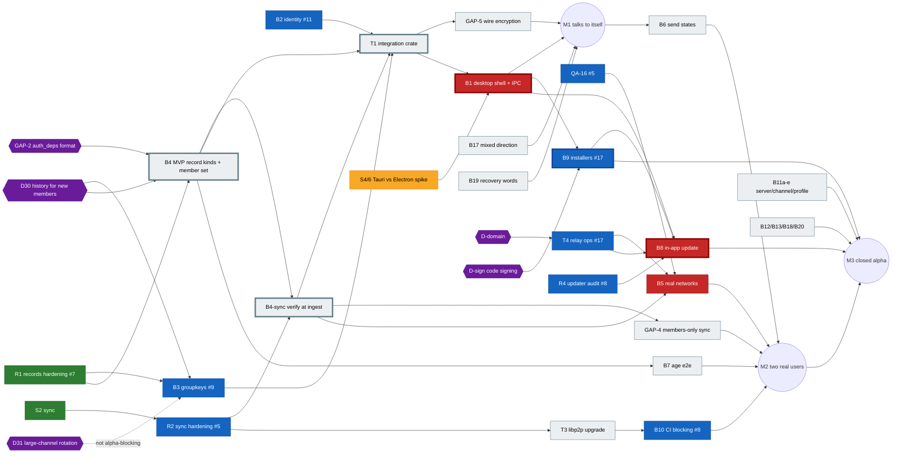

# MVS task board

The single source of truth for who does what, in which order, and what blocks the closed alpha.
Owner: pm (see [`docs/TEAM.md`](TEAM.md)). Updated whenever a PR lands; if this board disagrees with a PR, a review or a chat, **the board wins until it is corrected here**.

Last updated: 2026-11-03 ~07:20 UTC. `main` has PRs #1–#4, #6, #7, #10, #12, #13. Open: #5, #8, #9, #11, #14–#17.

**Contents:** [Rules](#rules) · [Milestones](#milestones) · [Open PRs](#open-prs) · [Board](#board) · [Dependency map and critical path](#dependency-map-and-critical-path) · [Next assignments](#next-assignments) · [File ownership](#file-ownership) · [Risks and blockers](#risks-and-blockers) · [Owner decisions](#owner-decisions)

---

## Rules

- **Owner column** uses the handles in [`docs/TEAM.md`](TEAM.md) (e.g. `tech-lead`, `dev-sync`, `product-lead`). `core-5` is an open core-developer slot.
- **Status:** `todo` · `in progress` · `in review` (PR open, waiting for a verdict) · `blocked` (named blocker) · `done` (merged to `main`).
- **Size:** S ≤ 1 PR of a day, M = 1–2 PRs, L = several PRs or a new crate.
- **Milestones:** M1, M2, M3 (below). `–` means after the closed alpha.
- **IDs** are the ones the source documents use, so they can be grepped: `B*` backlog (`docs/reviews/po-review-1.md`), `UX-*` (`docs/reviews/ux-review-1.md`), `QA-*` (`qa/BUGS.md`, PR #13), `U*` PO screenshot bugs, `ש-*` PO spec questions, `GAP-*` threat model (`docs/security/threat-model.md`, PR #15), `D*` owner decisions (spec decision log), `R*` review findings and `S*` spikes (this board), `T*` items that only exist here.
- **Review flow** ([TEAM.md](TEAM.md#review-flows)): engineering PRs need tech-lead (+ sec-lead for crypto, identity, permissions, network) → manager merges. A lead's own PR is reviewed by another lead.
- **Product review gate:** product, UX, business, QA-plan and board PRs need a `VERDICT: APPROVE` from product-lead. product-lead's own PRs are reviewed by ux (plus another lead). Engineering features are accepted or rejected by product-lead against their acceptance criteria before they are marked `done`.
- **Acceptance criteria:** B-items in `docs/reviews/po-review-1.md` §8; T-items in [T acceptance criteria](#t-acceptance-criteria) below.
- Before starting an item, check [File ownership](#file-ownership). One writer per path at a time.
- Never commit IPs, keys, `.env` files or real tester data.

## Milestones

| | Name | Done when |
| --- | --- | --- |
| **M1** | Talks to itself | One desktop build runs the real Rust core behind the UI (no mock): create an identity from 12 words, create a server, post encrypted messages, restart and see them again. Two instances on one machine sync. |
| **M2** | Two real users chat | Two people on different machines and networks (incl. one behind NAT/CGNAT, via relay) join by link, chat with real send states, kick works and re-keys, offline catch-up works. B5 success criteria measured and committed. Threat-model P0 gaps closed. |
| **M3** | Closed alpha release | Installers for Windows, macOS, Linux from CI (signed or documented-unsigned); in-app P2P update with rollback; relay + seeder running behind the owner's domain; P0 bugs closed; testers have instructions. |

## Open PRs

| PR | What | Author | Required verdicts | Status | Next step |
| --- | --- | --- | --- | --- | --- |
| [#5](https://github.com/moranmoa/MVP/pull/5) | sync hardening + QA-16 spike-peer timeout | dev-sync | tech-lead, sec-lead | in review | tech-lead APPROVE (`3bb79db`); sec-lead verdict, then merge |
| [#8](https://github.com/moranmoa/MVP/pull/8) | updater audit, root rotation (R4), QA-14/15; CI ui job, pinned actions | dev-updater | tech-lead, sec-lead | in progress | tech-lead CHANGES REQUESTED on `7419319` |
| [#9](https://github.com/moranmoa/MVP/pull/9) | groupkeys: per-channel epoch keys | dev-crypto | tech-lead, sec-lead | in progress | tech-lead CHANGES REQUESTED on `218b073` |
| [#11](https://github.com/moranmoa/MVP/pull/11) | identity: 12 recovery words, keychain vault | dev-identity | tech-lead, sec-lead | in review | sec-lead APPROVE (`8422149`); needs tech-lead verdict |
| [#14](https://github.com/moranmoa/MVP/pull/14) | this board + `docs/TEAM.md` | pm | product-lead | in review | product-lead re-review |
| [#15](https://github.com/moranmoa/MVP/pull/15) | threat model, relay review, PR checklist | sec-lead | tech-lead (lead's own PR) | in review | review |
| [#16](https://github.com/moranmoa/MVP/pull/16) | business plan 1 (alpha, money, legal drafts, decisions §5) | biz | product-lead | in progress | product-lead CHANGES REQUESTED |
| [#17](https://github.com/moranmoa/MVP/pull/17) | release pipeline (`release.yml`, draft pre-release, offline signing) + hardened relay ops (Caddy) | devops | tech-lead, sec-lead (relay) | in review | review |

Merged since the first board: #6 (PO review + backlog), #7 (records hardening), #10 (UI security), #12 (UX review), #13 (QA plan).

**Merge order for core** (keeps `core/Cargo.toml` / `Cargo.lock` conflicts to one line): #5 → #11 → #9 → #8. Each later PR rebases and keeps every crate in `members`. Docs PRs (#14–#16) merge any time. #17 touches `infra/` and `.gitignore` only, no conflict with core.

---

## Board

### Foundations (core crates)

| ID | Title | Owner | Status | PR | Depends on | Size | MS |
| --- | --- | --- | --- | --- | --- | --- | --- |
| S1 | Signed update chain (`core/updater`) | dev-updater | done | #1 | – | M | M3 |
| S2 | Log sync spike (`core/sync`) | dev-sync | done | #2 | – | M | M1 |
| S3 | Signed records + incremental authority | tech-lead | done | #3 | – | M | M1 |
| R1 | Records/authority hardening: genesis binding, pending-queue flood, `mvs/` contexts | tech-lead | done | #7 | S3 | M | M1 |
| R2 | Sync hardening: canonical deps, bounded input, global pull limit | dev-sync | in review | #5 | S2 | M | M1 |
| B2 | Identity: 12 words, keychain, restore (+ QA-01 core side) | dev-identity | in review | #11 | – | S | M1 |
| B3 | Group encryption by epoch, re-key on kick | dev-crypto | in review | #9 | S3; D30 for final shape | L | M1 |
| R4 | Updater audit: root-rotation chain DoS, QA-14, QA-15 | dev-updater | in review | #8 | S1 | S | M3 |
| QA-16 | `spike-peer` hangs when relay is unreachable | dev-sync | in review | #5 | – | S | M2 |
| T2 | All crypto domain strings `mvs/…`, pinned by tests | each crate owner | in review | #5 #8 #9 #11 (records done in #7) | – | S | M1 |
| B4 | MVP record kinds: server edit/close, channels, invite + revoke, **Join + member set (GAP-3)**, edit/delete tombstones, leave, age claim, kick blocks rejoin (ש-4); revoke-only demotion (D28); `Kind::KeyRotation` ~48 KiB (R7); **`auth_deps` format for channel messages (GAP-2)**; `#general` auto-named (UX-04) | core-5 (tech-lead until staffed) | todo | – | R1 ✔; D30 for history flag; GAP-2 format decision by tech-lead + sec-lead | L | M1 |
| B4-sync | Verify records at ingest and before gossip forward (GAP-1); roles only from the signed log | dev-sync | todo | – | R2, B4 kinds | M | M1 |
| GAP-4 | Answer sync only for members: peer-ID ↔ identity binding, secret-derived topic names | dev-sync | todo | – | B4 (member set), B4-sync | M | M2 |
| GAP-6 | Kademlia client mode, filter private addresses, `/mvs/kad/1.0.0` | dev-sync | todo | – | R2 | S | M2 |
| B23 | Name sanitising in core: bidi controls, invisible chars (QA-13, QA-06) | core-5 | todo | – | B4 | S | M2 |
| T1 | **Integration crate** — one crate that wires sync → records → authority → groupkeys (sec-lead's proposed `core/node`) and exposes the `CoreApi` facade matching `ui/src/core/api.ts` commands, events and error codes. Name/split (`core/node` vs `core/api`) decided by tech-lead | dev-identity (lead), dev-crypto (crypto module, GAP-5) | todo | – | B2, R2, B3, B4 (initial kinds) | L | M1 |
| GAP-5 | Wire encryption into T1: `Kind::KeyRotation`, `may_rotate`, feed `set_voided` from authority | dev-crypto | todo | – | T1 skeleton, B4 (`KeyRotation`) | M | M1 |

### Shell, packaging, release

| ID | Title | Owner | Status | PR | Depends on | Size | MS |
| --- | --- | --- | --- | --- | --- | --- | --- |
| S4/6 | Spike 4+6: voice + footprint, **Tauri vs Electron** | dev-voice-shell | in progress | – | – | M | M1 |
| S5 | Spike 5: browser peer interop with native peers | dev-web | in progress | – | S2 | M | – |
| B1 | Desktop shell (per S4/6) + real `CoreApi` over IPC; core in its own process; mock stays at `?demo`; minimal IPC surface (GAP-17) | dev-voice-shell | blocked (S4/6) | – | S4/6, T1 | L | M1 |
| B10 | CI: ui job (#8), `qa/` smoke on every PR, advisories blocking, `ring` exception permanent (D29) | dev-updater | in review | #8 | #13 for smoke; T3 for blocking | S | M2 |
| T3 | libp2p 0.54 → current (clears `ring 0.16` advisories, rcgen, hickory) | dev-sync | todo | – | #5 merged | M | M2 |
| B9 | Installers: release workflow + archives + `SHA256SUMS` + unsigned manifest body (in #17); then EXE/MSI, DMG, AppImage/deb/rpm via the shell plug-in point; third-party notices; SmartScreen/Gatekeeper notes | devops | in review (pipeline) / blocked (packaging on B1) | #17 | B1; D-sign | M | M3 |
| T4 | Relay + seeder + bootstrap in Docker on the owner's machine behind Caddy and the owner's domain (D24); relay limits raised for catch-up; stop logging who talks to whom (GAP-7); relay lockfile + pinned images (R7-relay) | devops | in review | #17 | D-domain for go-live | M | M2 |
| B8 | In-app update: P2P + seeder, verify before install/forward, rail icon (UX-14), rollback after 3 failed starts, "what's new" from signed `notes` (ש-24) | dev-updater | blocked (B1) | – | R4, B1, B9, T4 | M | M3 |
| B5 | Real networks: 3 machines (home/cellular/work, 3 OSes), p95 < 1 s, creator leaves and others continue, offline catch-up via relay only, `spike-peer` ≥ 10 pairs ≥ 95 % (results committed, no IPs) | dev-sync + qa | blocked (QA-16 #5, T4) | – | QA-16, T4, B4-sync | M | M2 |
| B14 | UI performance in the real shell (incl. < 50 ms pending echo for B6) | dev-web | todo | – | B1 | M | M3 |
| B15 | Real diagnostics export from core | dev-identity | todo | – | T1 | S | M3 |

### Product features (UI + core)

| ID | Title | Owner | Status | PR | Depends on | Size | MS |
| --- | --- | --- | --- | --- | --- | --- | --- |
| B6 | Real send states: pending/sent/delivered (receipt ack ש-11), failed + retry; composer 16 KiB cap and no text loss (QA-10) | dev-sync (ack) + dev-ui (composer) | todo | – | B4-sync, T1; QA-10 part can start now | S | M2 |
| B7 | Age end-to-end: < 16 blocked, 120-year check (QA-04), signed age claims, 18+ channels hidden (ש-12), DOB correction rules, UX-15, UX-23 | core-5 (claims) + dev-ui | todo | – | B4 | M | M2 |
| B11a | Leave server (owner blocked, ש-19) | dev-ui | todo | – | B4 for core | S | M3 |
| B11b | Edit / close server (ש-22, ש-23) | dev-ui | todo | – | B4 | M | M3 |
| B11c | Channels: create, rename, delete (ש-20), 18+ flag | dev-ui | todo | – | B4 | M | M3 |
| B11d | Revoke invite + new link (ש-21) | dev-ui | todo | – | B4 | S | M3 |
| B11e | Edit profile: name, avatar, banner, bio (UX-02, UX-16, QA-02, QA-03) | dev-ui | todo | – | – (mock first) | S | M2 |
| B12 | Display bugs + 200 % / 24 px check (U1, U2, U4–U6, UX-05, UX-17, QA-12). **UX-19 (decided by product-lead):** identity code stays next to the name on every message, 0.75rem, `--text-muted`, `aria-hidden` on the code, `aria-labelledby` on the article | dev-ui | todo | – | – | M | M3 |
| B13 | Wording, product name MVS (`mvs://`, `app.name`, `document.title`), spec updates (ש-1, ש-2, ש-5, ש-8, ש-9), UX-39, UX-40 | product-lead (spec + string table), dev-ui (i18n files) | todo | – | – | S | M2 |
| B17 | Mixed-direction text in messages and strings (UX-01 blocker, UX-03, UX-18) | dev-ui | todo | – | – | S–M | M1 |
| B18 | P2P states in UI: own new server, offline server, background join (UX-07..09, QA-08) | dev-ui + dev-sync (API contract) | todo | – | T1 contract for background join | M | M2 |
| B19 | Recovery-words screen safety: resume after reload (QA-01), reading order, hidden by default (UX-05, UX-06, U1) | dev-ui | todo | – | B2 for persistence | S | M1 |
| B20 | Contrast AA (UX-13) | dev-ui | todo | – | – | S | M3 |
| B16 | Settings export/import, message density, date separators (UX-12) | dev-ui | todo | – | – | M | – |
| B21 | Accessibility + keyboard (UX-11, UX-20, UX-21, UX-34, UX-37, UX-38) | dev-ui | todo | – | – | M | – |
| B22 | Flow polish (UX-22..32 part, UX-41..48, QA-05, QA-07, QA-09, QA-11) | dev-ui | todo | – | – | M | – |
| UX-10 | `mvs://` links not clickable in WhatsApp/Telegram/Discord → https landing page on the owner's domain | devops + dev-ui | blocked (D-domain) | – | D-domain, T4 | S | M3 |

### Reviews, QA, security, business

| ID | Title | Owner | Status | PR | Depends on | Size | MS |
| --- | --- | --- | --- | --- | --- | --- | --- |
| PO-1 | PO review 1 + backlog B1–B23 | product-lead | done | #6 | – | M | M1 |
| UX-R1 | UX review 1 (48 findings, mapped into B12/B13/B17–B22) | ux | done | #12 | – | M | M1 |
| UI-SEC | UI security audit + phone layout | dev-ui | done | #10 | – | M | M1 |
| QA-P1 | QA plan + Playwright smoke + bug list | qa | done | #13 | – | M | M1 |
| T11 | UX specs before build: B17 → B19 → B11e → B18 → B11a–d in `docs/ux/specs/` | ux | todo | – | – | M | M1–M3 |
| T5 | Threat model, relay review, PR checklist | sec-lead | in review | #15 | – | M | M2 |
| T6 | Business plan 1: alpha recruitment, costs, legal drafts, owner decisions §5 | biz | in review | #16 | – | M | M3 |
| T10 | Team structure + review flows (`docs/TEAM.md`) | pm | in review | #14 | – | S | M1 |
| T7 | QA on the real shell: rerun smoke + SC-01..SC-04 against the B1 build | qa | blocked (B1) | – | B1 | M | M2 |
| T8 | UX review 2 on the real shell (desktop, phone-width, 200 %) | ux | blocked (B1) | – | B1, B17, B12 | M | M3 |
| T9 | Alpha release checklist + go/no-go | manager + product-lead | todo | – | M2 | S | M3 |

### Review findings (open)

| ID | Finding | PR | Owner | Status |
| --- | --- | --- | --- | --- |
| R2 | Non-canonical deps: a stored blob is served back under a different id | #5 | dev-sync | fixed, awaiting re-review |
| R3 | A groupkeys rotation voided later by authority can't be withdrawn → peers diverge | #9 | dev-crypto | fixed (`set_voided`), awaiting re-review |
| R4 | Any peer can block root rotation → client frozen on old root | #8 | dev-updater | fixed; tech-lead re-review requested more changes |
| R7 | `KeyRotation` doesn't fit a 16 KiB record above ~203 members | #9 → B4 | core-5 | todo (B4) |
| R8 | identity: macOS build and real OS keychain not exercised in tests | #11 | dev-identity + devops | todo (macOS runner) |
| GAP-1..7, GAP-17 | Threat-model P0 gaps: no ingest verification, no `auth_deps`, no member set, sync answers anyone, no wire encryption, DHT leaks IPs, relay logs pairs, IPC surface | #15 | see B4-sync, B4, GAP-4, GAP-5, GAP-6, T4, B1 | todo |

Closed since the first board: R1 (#7), R5 (#11 security APPROVE), R6 (#13).

### T acceptance criteria

B-items: `docs/reviews/po-review-1.md` §8. T2 and T5–T8 are as written in their rows.

| ID | Acceptance criteria |
| --- | --- |
| T1 | The crate exposes every command and event in `ui/src/core/api.ts`, with the same names, the JSON shapes from `types.ts` and the same error codes; a parity test fails if `api.ts` and the crate disagree. Every call is async and answers from the local store, without waiting on the network. An integration test covers M1: create an identity, create a server, send a message, restart and see it again; two instances on one machine sync. Peer input reaches T1 only through `Record::decode`, and a malformed-input test proves there's no panic. The UI contract tests pass against both the mock and T1. |
| T3 | libp2p is upgraded and all tests are green; `ring 0.16` and `rcgen 0.11` are gone from `Cargo.lock`; the advisories job is clean, or each remaining advisory is listed with a reason. |
| T4 | One compose file runs relay, seeder and bootstrap, with a templated hostname and no IPs in git. TLS comes from the reverse proxy, which forwards only WebSocket; TCP/UDP ports are documented. Relay circuit limits are raised so 10,000 missed messages catch up over a relay-only path, measured. Restart policies and a health check are in place. |
| T9 | The go/no-go checklist covers the spec's Definition of Done, M3 "done when", all Blocker/High bugs closed, SC-01..04 results committed, and tester instructions (install, unsigned-build warnings if relevant, how to export diagnostics). |
| T11 | Each spec has RTL and LTR layouts, all states, exact Hebrew and English strings, keyboard and screen-reader behaviour, and acceptance checks; product-lead approves it before dev-ui starts the item (B17 may start from UX-01 now). |

---

## Dependency map and critical path



Legend: green done · blue in review · yellow in progress · red blocked · grey todo · purple decision · thick border = critical path.

### Critical path to the closed alpha

```
B4 MVP record kinds ─► B4-sync ─► T1 integration crate ─► B1 desktop shell ─► B9 installers ─► B8 in-app update ─► M3
   ▲          ▲                      ▲        ▲                ▲
  D30     GAP-2 format          B2 (#11)  B3 (#9)        S4/6 spike
```

- **Longest chain:** B4 (L) → B4-sync (M) → T1 (L) → B1 (L) → B9 (M) → B8 (M). R1 is now done, so **B4 is the head of the path and has no developer** (core-5 slot open; see K13).
- **Non-code gates on the path:** D30 and the GAP-2 `auth_deps` format (B4), S4/6 result (B1), D-domain (T4 → B5, B8), D-sign (B9).
- **Biggest lever:** staff B4 now, and start T1 as soon as #11 and #5 merge, against the kinds that exist.
- **Parallel path to M2:** T4 relay ops (#17) → B5 real-network run; GAP-4 members-only sync.

---

## Next assignments

What each agent picks up **after its current PR merges**, the lead who assigns it, and the paths it may write. No two rows share a writable path at the same time.

| Agent | Assigned by | Now | Next (in order) | Writes | Must not touch |
| --- | --- | --- | --- | --- | --- |
| **core-5** (open slot) | tech-lead → core sub-lead | – | 1. **B4** incl. member set (GAP-3), `auth_deps` (GAP-2), `KeyRotation` (R7), revoke-only demotion (D28). 2. B7 age-claim records. 3. B23 core name sanitising. | `core/records/**`, `core/authority/**` | `core/sync`, `core/groupkeys`, T1 crate |
| **tech-lead** | manager | reviews #5, #8, #9, #11, #17; #15 as other lead | 1. Decide GAP-2 format with sec-lead and the T1 crate name/split. 2. Hold `core/records` + `core/authority` until core-5 starts (if no core-5, tech-lead does B4 and sec-lead reviews it). | `core/records/**`, `core/authority/**` (custodian) | – |
| **dev-sync** | tech-lead → dev-identity | #5 | 1. **B4-sync** (GAP-1). 2. GAP-6 Kademlia client mode. 3. GAP-4 members-only sync (after B4 member set). 4. Receipt ack for B6 (ש-11). 5. T3 libp2p upgrade (alone, see conflicts). 6. B5 run with qa. | `core/sync/**`, `core/spike-peer/**` | `core/records`, `infra/` |
| **dev-identity** (core sub-lead) | tech-lead | #11 | 1. **T1** integration crate skeleton (identity + records + authority + sync wired; `CoreApi` parity). 2. B15 diagnostics. 3. Split core assignments among core devs. | T1 crate (`core/node/**` or `core/api/**`), `core/identity/**` | `ui/**` (contract changes go to dev-ui) |
| **dev-crypto** | tech-lead → dev-identity | #9 | 1. **D30 + D31 recommendation** to the owner. 2. GAP-5 crypto module in T1 after the skeleton merges. 3. B3 acceptance: relay sees only ciphertext; 500-member rotation size. | `core/groupkeys/**`; T1 `src/crypto/**` after skeleton | rest of T1 crate, `core/records` |
| **dev-updater** | tech-lead → dev-identity | #8 | 1. B10: `qa/` smoke job in `ci.yml` (after #13); advisories blocking after T3. 2. **B8** in-app update after B1 + B9. | `core/updater/**`, `.github/workflows/ci.yml`, `.github/scripts/npm-licenses.mjs`, `.github/scripts/install-cargo-deny.sh`, `.github/dependabot.yml`, `core/deny.toml` | `release.yml`, `.github/scripts/manifest-body.mjs` |
| **dev-voice-shell** | tech-lead → dev-ui | S4/6 spike | 1. Spike results + recommendation (decision log lines 1 and 7). 2. **B1** desktop shell + IPC `CoreApi`; fill the shell plug-in point in `release.yml` with devops. | `desktop/**` (new; or `ui/src-tauri/**`), `ui/src/core/ipc.ts` (new) | other `ui/src/**`, `release.yml` (send devops a patch) |
| **dev-web** | tech-lead → dev-ui | S5 spike | 1. Spike 5 results doc. 2. **B14** UI perf harness in the real shell (after B1). Until then: S5 follow-ups only. | spike dir, later `perf/**` (new) | `ui/**`, `qa/**` |
| **dev-ui** (client sub-lead) | tech-lead | – (#10 merged) | 1. **B17** mixed direction (from the UX spec; may start now from UX-01, already specified). 2. **B19** recovery-words safety (from the UX spec; QA-01, U1). 3. QA-10 composer cap. 4. B11e profile (from the UX spec; mock). 5. B13 strings from product-lead's table. 6. B12 (incl. UX-19), B20, B18 (from the UX spec), B11a–d (from the UX spec). | `ui/**` (sole writer, incl. `ui/src/i18n/*.json`) | `ui/src/core/ipc.ts`, `desktop/**` |
| **devops** | tech-lead | #17 | 1. Land #17 (release pipeline + Caddy relay). 2. **T4** go-live once D-domain is decided. 3. macOS runner for R8. 4. **B9** packaging once B1 lands. | `infra/**`, `.github/workflows/release.yml`, `.github/scripts/manifest-body.mjs`, `docs/release/**`, `packaging/**` (new) | `ci.yml` (dev-updater) |
| **sec-lead** | manager | #15 | 1. Land #15. 2. GAP-2 format with tech-lead. 3. Standing review on #5, #8, #9, #17 and every B4/B4-sync/T1/GAP PR (`PR-CHECKLIST.md`). 4. Key custody for D-sign / D23. | `docs/security/**` | crate code (findings go to owners) |
| **qa** | manager | – (#13 merged) | 1. B5 run with dev-sync. 2. T7 rerun on the real shell. | `qa/**` | `ui/**`, `ci.yml` (ask dev-updater) |
| **product-lead** | manager | reviews #14, #16 | 1. **B13**: spec updates + a ready-to-paste string table. 2. Acceptance of engineering deliveries against criteria. 3. Review of product/UX/business/QA/board PRs. Also folds sec-lead's GAP decisions and biz §5 into the spec once decided. | `docs/spec.md`, `docs/reviews/po-*` | `ui/src/i18n/*` |
| **ux** | product-lead | – (#12 merged) | 1. **T11 UX specs**, in order: B17 → B19 → B11e → B18 → B11a–d, in `docs/ux/specs/` (layouts in RTL and LTR, all states, exact Hebrew and English strings, keyboard and screen-reader behaviour, acceptance checks). 2. Visual review of dev-ui's PRs against those specs. 3. T8 after B1. | `docs/ux/**`, `docs/reviews/ux-*` | `ui/**` |
| **biz** | product-lead | #16 | 1. Walk the owner through §5 (domain, signing, licence/open-source timing, relay on VPS, trademark). 2. Tester recruitment wave 1 with product-lead. | `docs/business/**` | – |
| **pm** | manager | #14 | Update the board whenever a PR lands; flag conflicts. | `docs/BOARD.md`, `docs/TEAM.md` | everything else |

### File-ownership conflicts to manage

| Path | Who wants it | Rule |
| --- | --- | --- |
| `core/Cargo.toml` `members`, `core/Cargo.lock` | #5, #8, #9, #11, then T1, T3 | One-line conflict each time: **keep every crate**, regenerate the lock and commit it. Follow the merge order. T3 (libp2p) lands alone, not with T1's first PR. |
| `core/records/**`, `core/authority/**` | B4, B7 claims, B23 (core-5), R7 `KeyRotation` (dev-crypto's requirement), GAP-2/3 (sec-lead's findings) | core-5 only (tech-lead until staffed). Others file requirements; they don't edit. |
| **T1 crate: `core/node` (sec-lead, #15) vs `core/api` (this board)** | dev-identity, dev-crypto, dev-sync | **Conflict:** two names for the same glue. tech-lead picks one crate before T1 starts. Recommendation: a single `core/node` that does the ingest checks and exposes the `CoreApi` facade. dev-identity owns it; others add modules in their own subdirectory after the skeleton merges. |
| `core/spike-peer/src/main.rs` | #5 (QA-16), B5 | dev-sync only; qa runs it. |
| `ui/src/core/*` | dev-ui (types, mock), dev-voice-shell (IPC), T1 contract | `api.ts`/`types.ts`/`mock.ts`/`index.ts` = dev-ui; `ipc.ts` = dev-voice-shell. A contract change is a dev-ui PR first; IPC follows. |
| `ui/src/i18n/*.json` | dev-ui, B13/UX-39/40 (product-lead, ux) | dev-ui is the only writer; product-lead/ux deliver a string table. |
| `.github/workflows/ci.yml` | #8 (dev-updater), B10 smoke (qa) | dev-updater only. |
| `.github/workflows/release.yml` | #17 (devops), B1 shell packaging (dev-voice-shell), B8 updater payload (dev-updater) | devops only; others send the step as a patch or PR comment. |
| `.github/scripts/**` | #8 (`npm-licenses.mjs`, `install-cargo-deny.sh`), #17 (`manifest-body.mjs`) | Split per file as in the table above. |
| `docs/spec.md` | product-lead; inputs from dev-crypto (D30/D31), sec-lead (GAPs), biz (§5) | product-lead only. |
| `infra/**`, `.gitignore` | devops (#17), dev-sync (relay limits) | devops only; dev-sync specifies limits. `.gitignore` changes go through devops. |

---

## Risks and blockers

| # | Risk / blocker | Impact | Mitigation | Owner |
| --- | --- | --- | --- | --- |
| K1 | **S4/6 Tauri vs Electron** undecided | B1, B9 packaging, B8, B14, T7, T8 wait | Timebox the spike; #17's shell plug-in point already lets the pipeline ship plain archives | dev-voice-shell, tech-lead |
| K2 | **D30 history for new members** pending | B4 history flag, B3 final behaviour, join copy | dev-crypto recommendation; B4 reserves the field | owner, dev-crypto |
| K3 | **D31 large-channel rotation** pending | > ~200 members per kick > 16 KiB; not alpha-blocking | Alpha caps servers below; `KeyRotation` ~48 KiB covers ~500 (R7) | owner, dev-crypto |
| K4 | **Domain + reverse proxy** (D24) undecided | T4 go-live, B5 relay-only runs, B8 seeder, UX-10 | biz §5 memo; #17 keeps the host templated (`.env.example`) | owner, biz, devops |
| K5 | **Code signing** undecided | SmartScreen/Gatekeeper friction; macOS keychain may differ unsigned (R8) | biz §5 costs; #17 already ships unsigned archives + offline manifest signing | owner, biz, devops |
| K6 | **Threat-model P0 gaps** (GAP-1..7): crates are solid alone, nothing wires them | M2 security bar; an outsider can read/flood a server today | Gaps mapped to B4, B4-sync, GAP-4/5/6, T4, B1; sec-lead reviews each | tech-lead, sec-lead |
| K7 | Many parallel core PRs touching `Cargo.toml`/`Cargo.lock` | Rebase churn, CI `--locked` failures | Fixed merge order; T3 alone | pm, manager |
| K8 | libp2p 0.54 advisories (8 RustSec) | Advisories can't be blocking (B10) | T3 after #5 | dev-sync |
| K9 | Real NAT/CGNAT never tested; relay circuit limits cut large catch-up | M2 success criterion | QA-16 (#5), relay limits in T4, B5 with cellular | dev-sync, devops, qa |
| K10 | UX-01 mixed-direction blocker in chat | Hebrew users see garbled messages | B17 first for dev-ui | dev-ui |
| K11 | QA-01 recovery words lost on reload | Account can never create a server | B19 + B2 persistence | dev-ui, dev-identity |
| K12 | macOS untested for identity/keychain (R8) | Silent failure on 1 of 3 alpha OSes | macOS runner | devops |
| K13 | **B4 has no developer** and heads the critical path; tech-lead now reviews every engineering PR | Either B4 stalls or tech-lead becomes the review bottleneck | Manager staffs core-5 for `core/records` + `core/authority`; fallback: tech-lead writes B4 and sec-lead reviews it | manager |
| K14 | Review load on tech-lead + sec-lead (5 engineering PRs open now) | Merge queue stalls | Sub-leads pre-review; follow the merge order; docs PRs go to product-lead | tech-lead, sec-lead |

## Owner decisions

Decided (spec decision log): D21 donations, D22 one recovery set, D23 one update key in closed alpha, **D24** helper servers in Docker on the owner's machine behind a reverse proxy with the owner's domain, D25 LGPL dynamic OK, D26 gender-neutral Hebrew, **D27 name MVS** (`mvs/` crypto strings), **D28 demotion only via revoke**, **D29 `ring` licence exception permanent**.

Also decided: **ש-1..ש-24**, the spec answers in `docs/reviews/po-review-1.md` §7, merged with #6. For example "נמסרה", "קוד זהות", English BIP39 words, DOB asked again on restore, kick blocks rejoin, 18+ channels hidden. ש-15 and ש-18 remain open as D30/D31. **UX-19** was decided by product-lead: the identity code stays next to every name, muted (folded into B12).

Waiting:

| ID | Decision | Waiting on | Blocks | Needed by |
| --- | --- | --- | --- | --- |
| D30 | History for new members: per-server setting — encrypted with no pre-join history, or public unencrypted? | dev-crypto recommendation | B4 history flag, B3 final shape, join copy (B13) | Before B4 merges (M1) |
| D31 | Key rotation in large channels (> ~200 members) | dev-crypto recommendation | Post-alpha scaling only | Before open alpha |
| D-domain | Which domain; reverse proxy is Caddy in #17 | biz §5 (#16) | T4 go-live, B5, B8, UX-10 | Before M2 |
| D-sign | Code signing for closed alpha: buy Windows + Apple certificates, or ship unsigned with instructions | biz §5 (costs), sec-lead (key custody, D23) | B9, R8 | Before M3 |
| biz §5 | Open-source timing and licence, relay to a VPS, "MVS" trademark, and 9 more | owner reads #16 §5 | Varies; none on the M1 path | Before M3 |
| GAP-2 | `auth_deps` format: the kick names the kicker's channel heads so backdated messages are voided (technical, tech-lead + sec-lead; owner informed) | tech-lead, sec-lead | B4 | Now |
