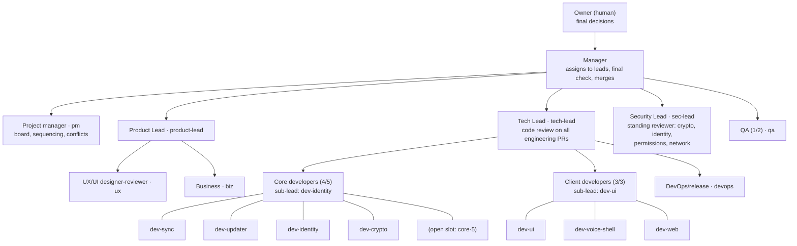

# MVS team

Who is who, who assigns work to whom, and who reviews what. `docs/BOARD.md` uses the **handles** below in every owner column.

Last updated: 2026-11-03.

## Rules

- Each role has a **limit** on how many agents may hold it. Starting another agent in a full role needs the Manager's OK.
- **Any role with more than one agent gets a manager from within it** (a sub-lead). The sub-lead hands out work inside the role and is the first point of contact; the parent lead still decides and reviews.
- Work flows down: the Owner decides, the Manager assigns to leads, and leads assign to their people. Nobody picks up work from another lead's people without going through that lead.
- Decisions flow up: an agent asks its lead; a lead asks the Manager; the Manager takes product, money, legal and crypto-format calls to the Owner.
- One writer per path at a time (see [File ownership](BOARD.md#file-ownership) on the board).

## Org chart

## Roster

| Role | Limit | Handle | Session | Reports to | Notes |
| --- | --- | --- | --- | --- | --- |
| Owner | – | owner | (human) | – | Final decisions; see [Owner decisions](BOARD.md#owner-decisions) |
| Manager | 1 | manager | `local_1cfed59a-d0bd-4012-a7fd-c4fbc10bb5d7` | owner | Assigns work to leads, does the final check, merges, escalates |
| Project manager | 1 | pm | board session (branch `claude/board`) | manager | Owns `docs/BOARD.md` and `docs/TEAM.md`; proposes sequencing, flags conflicts; assigns nothing directly |
| Product Lead | 1 | product-lead | `local_57eee4e7-2abf-48ee-b47c-3875e6ca93c4` (formerly po-review) | manager | Owns backlog and `docs/spec.md` |
| UX/UI designer-reviewer | 1 | ux | `local_6810d8fe-3653-46fb-95e1-80e429dc4059` (formerly ux-review) | product-lead | |
| Business | 1 | biz | `local_d4afaf47-1b52-4e6e-aa32-f019de02bef8` | product-lead | |
| Tech Lead | 1 | tech-lead | `local_2a92af99-b0f5-43e4-9291-5ddf4a89f52a` (formerly dev-records) | manager | Code review on every engineering PR; custodian of `core/records`, `core/authority` until core-5 is staffed |
| Core developer | 5 | dev-sync | `local_e464713b-f8f9-47d6-bfd5-32fd3ade7d80` | tech-lead (via core sub-lead) | `core/sync`, `core/spike-peer`, libp2p |
| Core developer | | dev-updater | `local_7f213b4d-4335-493c-b3e6-c9af8d5a1c2e` | tech-lead (via core sub-lead) | `core/updater`, `ci.yml` |
| Core developer — **core sub-lead** | | dev-identity | `local_31194a33-cd5f-4dc2-be0f-32e55c84845c` | tech-lead | `core/identity`; owns T1 (the integration crate), so it already touches every core crate's API |
| Core developer | | dev-crypto | `local_84b56eb9-fc9c-41bc-a3b7-a8cf9d1cdfb2` | tech-lead (via core sub-lead) | `core/groupkeys` |
| Core developer | | core-5 | open slot | tech-lead (via core sub-lead) | Proposed: take over `core/records` + `core/authority` (B4, B23, B7 claims) so tech-lead can review full-time |
| Client developer — **client sub-lead** | 3 | dev-ui | `local_7094f913-76df-4ab6-856b-1b112407e9dc` | tech-lead | `ui/**`; owns the `CoreApi` TypeScript contract |
| Client developer | | dev-voice-shell | `local_e592b541-5292-4530-b1da-e1736b764262` | tech-lead (via client sub-lead) | Tauri vs Electron spike, then desktop shell |
| Client developer | | dev-web | `local_af8e5619-71b6-4398-be3a-d5e39bee0862` | tech-lead (via client sub-lead) | Browser spike, then UI performance |
| DevOps/release | 1 | devops | `local_67210cc3-1f22-486a-8a1f-393d3dd63594` | tech-lead | `release.yml`, `infra/**`, installers |
| Security Lead | 1 | sec-lead | `local_eb4168eb-ddd8-4496-ac04-56bd966a13c8` | manager | Standing reviewer for crypto, identity, permissions and network PRs (`docs/security/PR-CHECKLIST.md`) |
| QA | 2 | qa | `local_c102d8fc-9f8d-46d1-9f74-2852608e11e7` (formerly qa-tester) | manager | Second slot open; when filled, one of the two becomes QA lead |

Sub-leads are the PM's nomination; the Manager confirms or swaps them. Old handles (`po-review`, `ux-review`, `qa-tester`, `dev-records`) still appear in PR history and session titles.

## Who assigns whom

| Assigner | Assigns to |
| --- | --- |
| owner | manager (decisions, priorities) |
| manager | pm, product-lead, tech-lead, sec-lead, qa |
| product-lead | ux, biz |
| tech-lead | dev-identity (core sub-lead), dev-ui (client sub-lead), devops; through the sub-leads: every core and client developer |
| core sub-lead (dev-identity) | splits tech-lead's core assignments between dev-sync, dev-updater, dev-crypto, core-5 |
| client sub-lead (dev-ui) | splits tech-lead's client assignments between dev-voice-shell, dev-web |
| pm | nobody; proposes on the board, the relevant lead assigns |

## Review flows

| PR type | Required verdicts | Then |
| --- | --- | --- |
| Engineering (`core/`, `ui/`, `infra/`, `.github/`, `qa/` code) | tech-lead `VERDICT: APPROVE`; **plus sec-lead** when it touches crypto, identity, permissions/authority or networking/relay | marked "ready to merge" → manager merges |
| Product, UX, business, QA plan, board/team docs | product-lead `VERDICT: APPROVE` | manager merges |
| A lead's own PR | another lead's verdict (tech-lead ↔ sec-lead for engineering; product-lead's PRs → tech-lead or sec-lead by topic) | manager merges |

A PR from a developer whose sub-lead is not tech-lead still goes to tech-lead; the sub-lead may add a first review but it doesn't count as the required verdict.
