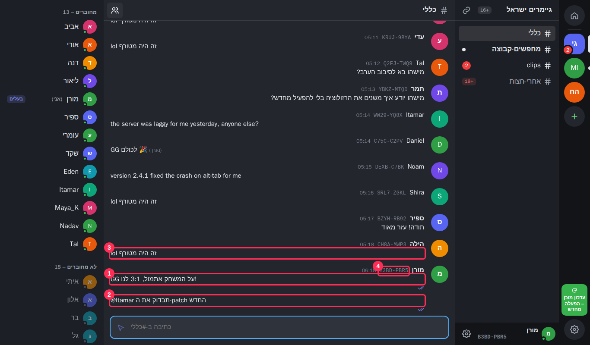
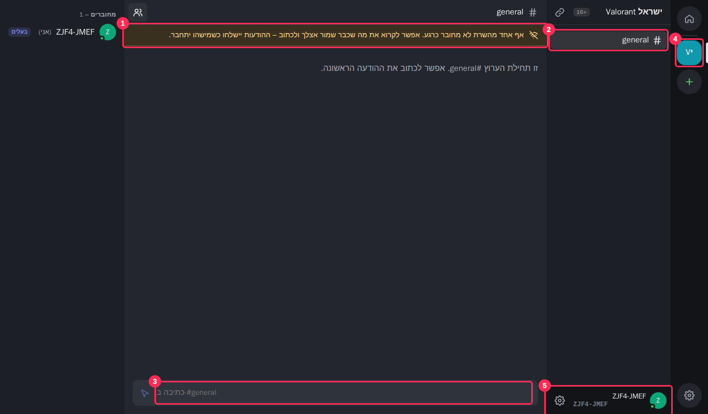
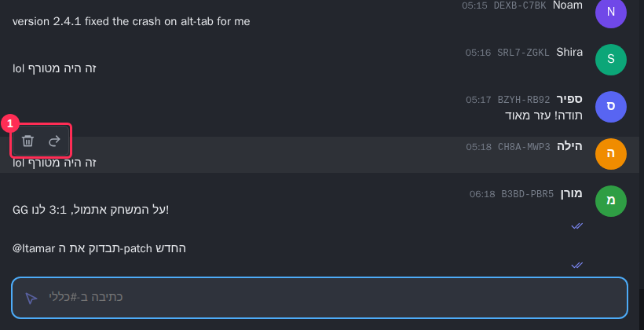
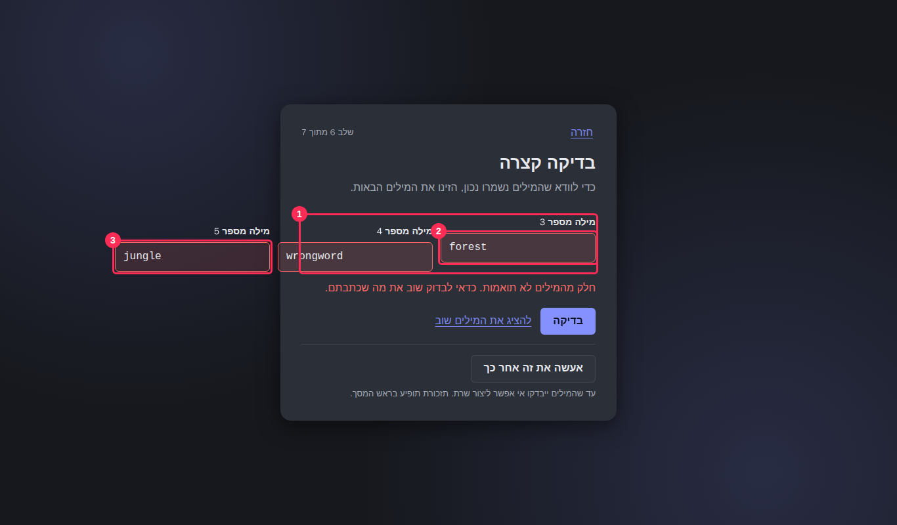
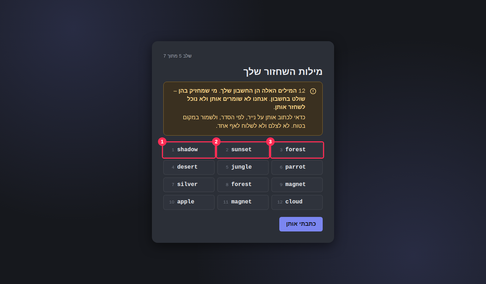
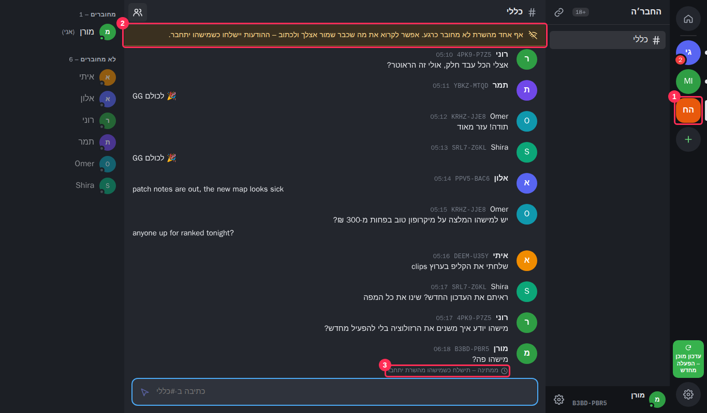
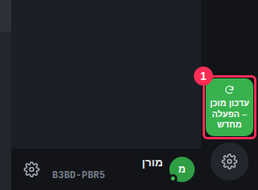
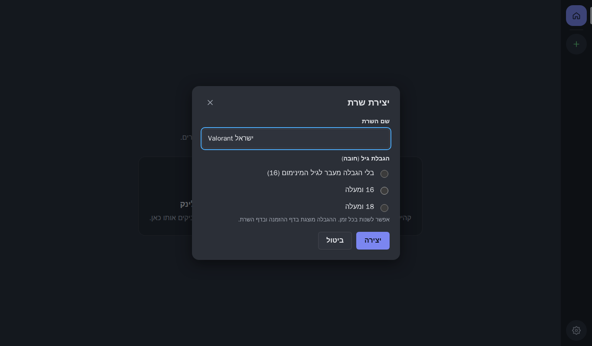
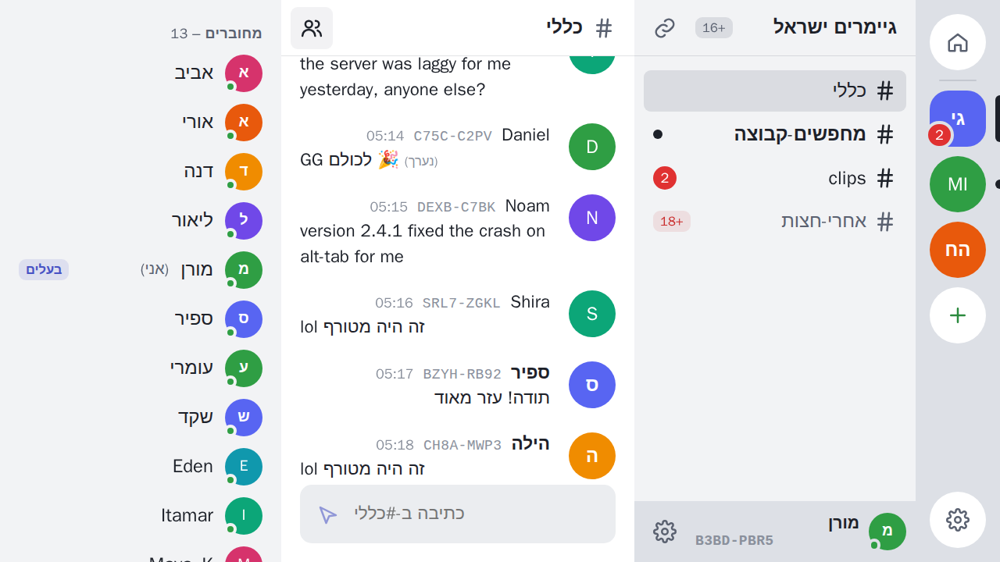
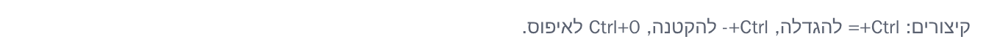

# סקירת UI/UX מס׳ 1 – מעטפת ה-MVP

- **מה נבדק:** `ui/` ב-main (commit `5ef10ff`, PR #4), עם ה-mock core.
- **איך:** הרצה ב-Docker (`ui/compose.yaml`), מעבר על כל התהליכים בדפדפן ב-1366×800 וב-1280×720, בעברית ובאנגלית, בערכה בהירה וכהה. בנוסף: 33 צילומי המסך ב-`ui/screenshots/`, בדיקת ניגודיות אוטומטית על כל הטקסט הגלוי (WCAG 2.2 AA), מעבר מקלדת בלבד, ומדידת זמן החלפת שרת.
- **לא נבדק:** פריסת טלפון (בעבודה אצל מפתח ה-UI), קורא מסך אמיתי (NVDA/VoiceOver) – נבדק רק עץ הנגישות.
- **צילומים מסומנים:** בתיקייה [`ux-review-1/`](ux-review-1/). המספרים האדומים בצילום תואמים להערות בממצא. הסקריפט שצילם אותם: [`ux-review-1/capture.mjs`](ux-review-1/capture.mjs) (Playwright מול שרת ה-dev; הוראות הרצה בראש הקובץ).

## תקציר

הבסיס טוב: עברית כברירת מחדל, CSS עם מאפיינים לוגיים, רשימת הודעות וירטואלית (החלפת שרת לוקחת 60–90ms גם בבניית dev), מצבי שליחה ברורים, ניווט מקלדת עם roving tabindex בפס השרתים וברשימת ההודעות, `<dialog>` עם החזרת פוקוס, ו-`role="alert"` על שגיאות. רוב הממצאים הם ליטוש.

שלושה דברים צריכים תיקון לפני שמשחררים לבודקים:

1. **טקסט מעורב עברית/אנגלית בהודעות נשבר** (UX-01). הודעה כמו "GG על המשחק אתמול, 3:1 לנו!" מוצגת הפוך ומיושרת לצד הלא נכון. זה המקרה הנפוץ ביותר אצל גיימרים ישראלים.
2. **אין דרך לקבוע שם תצוגה אחרי דילוג** (UX-02). מי שדילג נשאר עם קוד הזהות כשם, למרות שהמסך הבטיח "אפשר לשנות בכל רגע".
3. **מצבי P2P לא נראים במקום שהמשתמש מסתכל** (UX-07, UX-08, UX-09). שרת בלי אף אחד מחובר נראה בפס השרתים בדיוק כמו שרת פעיל, הצטרפות שממתינה ברקע נעלמת, ובשרת חדש מופיעה אזהרה מלחיצה במקום הזמנה לחברים.

| חומרה | כמות |
| --- | --- |
| Blocker | 2 |
| Major | 18 |
| Minor | 19 |
| דורש הכרעת מוצר | 1 (UX-19) |
| Polish | 8 |

**סדר עבודה:** החומרות לאלפא הסגורה, העדיפויות והשיוך למשימות (B2–B22) נקבעו בסקירת מנהל המוצר על PR #12, והן הקובעות. בקצרה: UX-01 ו-UX-02 קודם (B17, B11), ואחריהם מצבי P2P (B18), מסך מילות השחזור (B19) וטוקני הצבע (UX-13, ‏B20). UX-10 ו-UX-19 מחכים להכרעת מוצר.

**שם המוצר:** MVS. כל ניסוח שמוצע כאן ומזכיר את שם המוצר משתמש בשם הזה.

---

## 1. בלוקרים

### UX-01 · צ׳אט · Blocker – הודעות בעברית שמתחילות במילה לועזית מוצגות הפוך



**מה לא בסדר:** ‏`.msg-body` מקבל `dir="auto"`, והכיוון נקבע לפי התו החזק הראשון. בהודעה כמו "lol זה היה מטורף", "GG על המשחק…" או "@Itamar תבדוק את ה-patch החדש" התו הראשון לטיני, ולכן כל ההודעה הופכת ל-LTR:
- (1) "GG על המשחק אתמול, 3:1 לנו!" – סימן הקריאה קופץ לצד השני והמספרים מתערבבים.
- (2) "‎@Itamar תבדוק את ה-patch החדש" – הסדר נשבר סביב המקף.
- (3) "lol זה היה מטורף" מיושרת לשמאל, רחוק מהשם והאווטאר שמימין.

בממשק האנגלי זה קורה הפוך: הודעות בעברית נדחקות לקצה הימני, רחוק מהשם ([צילום 12](ux-review-1/12-english-ui-hebrew-messages.png)). גם הודעה שנייה ברצף מאותו אדם (למשל "anyone up for ranked tonight?" בצילום 22 המקורי) נראית כאילו אין לה כותב.

**תיקון:**
1. לקבוע את הכיוון לפי **רוב התווים החזקים** ולא לפי הראשון. פונקציה אחת ב-`MessageList.tsx`:
   ```ts
   // Counts strong RTL vs LTR letters; ties and empty text go to the UI direction.
   function textDir(text: string, uiDir: 'rtl' | 'ltr'): 'rtl' | 'ltr' {
     const rtl = (text.match(/[֐-׿؀-ۿ]/g) ?? []).length;
     const ltr = (text.match(/[A-Za-zÀ-ɏ]/g) ?? []).length;
     return rtl === ltr ? uiDir : rtl > ltr ? 'rtl' : 'ltr';
   }
   ```
   ולהציב `dir={textDir(m.body, uiDir)}` במקום `dir="auto"`. אפשר לשמור את התוצאה ב-`useMemo` לכל הודעה.
2. **היישור תמיד לצד של הממשק**, לא לפי כיוון ההודעה: ב-`.msg-body` להוסיף `text-align: right` כש-`html[dir=rtl]` ו-`text-align: left` כש-`ltr` (או `text-align: start` על אב עם הכיוון של הממשק ו-`unicode-bidi: plaintext` על הפסקה). כך ההודעה נשארת צמודה לשם, וסדר המילים בתוכה נכון.
3. אותו `textDir` גם ל-`reply-excerpt`, לתצוגה המקדימה בהגדרות ולתיבת הכתיבה (UX-03).
4. בדיקת יחידה עם המחרוזות: `"lol זה היה מטורף"`, `"GG על המשחק אתמול, 3:1 לנו!"`, `"@Itamar תבדוק את ה-patch החדש"`, `"version 2.4.1 fixed it"`, `"🎉🎉"`.

### UX-02 · Onboarding → פרופיל · Blocker – אין מקום לקבוע שם אחרי דילוג



**מה לא בסדר:** בשלב "איך יקראו לך?" יש "דילוג", והטקסט אומר "אפשר לשנות בכל רגע". אבל ב"הגדרות ← חשבון" יש רק מילות שחזור ([צילום 15](ux-review-1/15-settings-account.png)), ואין לחיצה על הפאנל שלי למטה. מי שדילג מופיע בכל מקום כ-"6U5E-A8YB" (5 בצילום), וברשימת החברים השם נחתך ל-"6U5E-A8…".

**תיקון:**
1. ב"הגדרות ← חשבון" להוסיף בראש העמוד את אותו טופס של שלב הפרופיל: תמונה, "שם תצוגה", "כמה מילים עליך (לא חובה)", קוד הזהות לקריאה בלבד. שמירה אוטומטית ב-blur, כמו שאר ההגדרות ("השינויים חלים מייד").
2. לחיצה על השם או האווטאר ב-`.me-panel` פותחת את ההגדרות ישר ב"חשבון".
3. בשלב הפרופיל: **לא לאפשר דילוג על השם.** להסיר את "דילוג", להשאיר רק "סיום", ולהשבית אותו עד שיש שם (תמונה ותיאור נשארים לא חובה). שם הוא הדבר שחברים צריכים כדי לזהות אותך, וכל שם ברירת מחדל בעברית ("שחקן", "אורח") הוא מגדרי.

---

## 2. Major

### UX-03 · צ׳אט → תיבת כתיבה · Major – תיבת כתיבה ריקה היא LTR, והטקסט המקדים נשבר



**מה לא בסדר:** ל-`textarea` יש `dir="auto"`. כשהיא ריקה הכיוון יוצא LTR: הסמן מתחיל משמאל בממשק עברי, והטקסט המקדים מיושר לשמאל, ליד כפתור השליחה. כששם הערוץ באנגלית, הטקסט המקדים מתפרק: "כתיבה ב-#general" מוצג בערך כ-"general#-כתיבה ב" (3 ב[צילום 07](ux-review-1/07-new-server-first-run.png)). אותו דבר ב-`aria-label` של רשימת ההודעות ובשורה "זו תחילת הערוץ #general."

**תיקון:**
- `dir={text ? textDir(text, uiDir) : uiDir}` (הפונקציה מ-UX-01) במקום `dir="auto"`.
- בכל מחרוזת ICU שמכניסה שם ערוץ, שם משתמש או שם שרת – לעטוף את המשתנה ב-FSI/PDI: `"chat.composer": "כתיבה ב-⁨#{channel}⁩"`. אותו דבר ל-`chat.messages`, `chat.empty`, `chat.replyingTo`, `members.open`, `profile.kickConfirm`. כדאי בדיקה ב-`i18n.test.ts` שכל `{channel}` ו-`{name}` עטופים.

### UX-04 · שרת חדש · Major – ערוץ ברירת המחדל נקרא "general" גם בעברית

**מה לא בסדר:** שרת שנוצר בממשק עברי מקבל ערוץ `general` (2 ב[צילום 07](ux-review-1/07-new-server-first-run.png)), בזמן שבשרתי הדמו הוא "כללי".

**תיקון:** השם של הערוץ הראשון נקבע לפי שפת הממשק ביצירה: `intl.formatMessage({ id: 'channel.defaultName' })` עם `"כללי"` / `"general"`, ונשלח ל-`createServer`. זה שם ולא מחרוזת ממשק, ולכן לא משתנה אחר כך כשמחליפים שפה.

### UX-05 · Onboarding → בדיקת מילים · Major – השדות יוצאים מהכרטיס



**מה לא בסדר:** ‏`.check-fields` היא grid של `repeat(3, 1fr)`, אבל ל-`input` יש רוחב מינימלי פנימי (~250px), אז העמודות לא מתכווצות ושני שדות יוצאים מהכרטיס שמאלה (1). בנוסף, כשמילה אחת שגויה, **כל** השדות מסומנים באדום (2, 3), גם אלה שנכונים.

**תיקון:**
```css
.check-fields { grid-template-columns: repeat(3, minmax(0, 1fr)); }
.check-fields input { min-width: 0; width: 100%; }
```
ובקוד: `checkRecoveryWords` מחזיר את המיקומים השגויים (כמו `restore` עם `positions`), ו-`aria-invalid` מוצב רק עליהם. ההודעה: "מילה מספר {n} לא תואמת. כדאי לבדוק מה נכתב בדף." (ובשתיים ומעלה: "המילים במקומות {positions} לא תואמות…", עם plural כמו ב-`restore.invalid`). אחרי שגיאה, הפוקוס עובר לשדה השגוי הראשון.

### UX-06 · Onboarding → מילות שחזור · Major – סדר הקריאה של הרשת לא חד-משמעי, והמילים גלויות מיד



**מה לא בסדר:**
- הרשת היא `dir="ltr"` עם 3 עמודות, כך ש-1 בשמאל ו-3 בימין (1–3 בצילום). קורא עברית סורק מימין לשמאל, רואה את "forest" ראשונה ועלול לכתוב את המילים בסדר הפוך. המספרים קטנים (12px) ובניגודיות 3.05:1, כך שהם לא עוזרים מספיק.
- המילים מוצגות מיד בגלוי. לקהל של גיימרים שמשדרים מסך (Twitch, Discord Go Live) זה סיכון ממשי.
- במוק יש מילים כפולות (forest ב-3 וב-8, magnet ב-9 וב-11). אם ליבה אמיתית מאפשרת כפילויות זה תקין, אבל זה מבלבל בכתיבה ידנית – כדאי לוודא מול צוות הליבה.

**תיקון:**
1. לסדר את הרשת **בעמודות** (1–4 בעמודה הראשונה, 5–8 בשנייה, 9–12 בשלישית): `grid-auto-flow: column; grid-template-rows: repeat(4, auto);`. כך הסדר ברור מלמעלה למטה בכל כיוון קריאה.
2. מספרים בגודל 0.875rem, `font-weight: 600`, בצבע `--text-muted` (ראו UX-13), וכפורמט "1." כדי שיהיה ברור שזה מספור.
3. להתחיל עם הרשת מטושטשת (`filter: blur(6px)`) ושכבה עם כפתור **"הצגת המילים"** ושורה: "כדאי לוודא שאף אחד לא רואה את המסך ושלא משדרים אותו." הכפתור "כתבתי אותן" מושבת עד שהמילים הוצגו.
4. להסיר את `aria-hidden` מ-`.word-num`, או לתת לכל `li` את `aria-label="מילה {n}: {word}"`, כדי שקורא מסך יקריא גם את המספר.

### UX-07 · שרת חדש · Major – בשרת שיצרתי עכשיו מופיעה אזהרה "אף אחד מהשרת לא מחובר"

**מה לא בסדר:** מיד אחרי "מעבר לשרת" מופיע הפס הצהוב "אף אחד מהשרת לא מחובר כרגע…" (1 ב[צילום 07](ux-review-1/07-new-server-first-run.png)). טכנית זה נכון, אבל בשרת שיש בו רק אותי זה נקרא כמו תקלה. המסר החשוב – שהשרת חי רק כשמישהו מחבריו מחובר – לא מוסבר בשום מקום.

**תיקון:**
- כשאני החבר היחיד: לא להציג את פס ה-offline. במקומו, מצב ריק במרכז הערוץ:
  - כותרת: "השרת מוכן. עכשיו צריך חברים."
  - טקסט: "אין שרת מרכזי: השרת קיים על המחשבים של החברים בו. כשיצטרפו עוד אנשים, הוא יישאר זמין גם כשהמחשב הזה כבוי."
  - כפתור ראשי: "העתקת לינק ההזמנה" (עם "הועתק ✓" ל-2 שניות).
- במסך "השרת מוכן" ([צילום 06](ux-review-1/06-server-ready-link.png)) להוסיף שורה מתחת ללינק: "השרת זמין כשלפחות מחשב אחד מהשרת מחובר."

### UX-08 · פס השרתים · Major – שרת שאף אחד בו לא מחובר נראה כמו כל שרת אחר



**מה לא בסדר:** ב"החבר׳ה" אף אחד לא מחובר ויש הודעה ממתינה, אבל באייקון בפס (1) אין שום סימן. המשתמש מגלה את זה רק כשהוא נכנס ורואה את הפס הצהוב (2). ההודעה הממתינה (3) מופיעה רק בתוך הערוץ, ואין דרך לבטל אותה.

**תיקון:**
1. באייקון השרת בפס: כשאין אף אחד מחובר – טבעת אפורה מקווקוות סביב האייקון ו-`opacity: .7` לאייקון בלבד. ב-tooltip ובשם הנגיש: "החבר׳ה · אף אחד לא מחובר".
2. כשיש הודעות ממתינות: תגית קטנה עם אייקון שעון ומספר, במקום התגית האדומה ("2 הודעות ממתינות").
3. בפס הצהוב בתוך הערוץ, כשידוע: "אף אחד מהשרת לא מחובר כרגע. מישהו היה מחובר לאחרונה {relativeTime}. אפשר לקרוא ולכתוב – ההודעות יישלחו כשמישהו יתחבר."
4. בהודעה ממתינה, לצד "ממתינה": כפתור "ביטול" (מוחק אותה מהתור המקומי). בתפריט הפעולות של הודעה ממתינה: "עריכה" ו"ביטול שליחה" במקום "מחיקה".

### UX-09 · הצטרפות · Major – הצטרפות שממשיכה "ברקע" נעלמת

**מה לא בסדר:** ב"להמשיך לחפש ברקע" ([צילום 17 המקורי](../../ui/screenshots/17-join-nobody-online.png)) הדיאלוג נסגר ואין שום סימן שמשהו ממתין. אי אפשר לבטל, ואי אפשר לדעת אם ההזמנה בכלל תקינה.

**תיקון:** אחרי "להמשיך לחפש ברקע" – להוסיף לפס השרתים אייקון זמני (עיגול מקווקו עם spinner ו-tooltip "מחפשים את השרת…"). לחיצה עליו פותחת חלונית קטנה: "מחפשים חברים מהשרת. נודיע כשמישהו יתחבר." עם הכפתור "הפסקת החיפוש". כשההצטרפות מצליחה – האייקון הופך לשרת, ומופיע toast: "ההצטרפות ל-{server} הצליחה".

### UX-10 · לינק הזמנה · Minor באלפא – תלוי בהכרעה על שם המוצר והדומיין – `mvp://` לא לחיץ בוואטסאפ, בטלגרם ובדיסקורד

**מה לא בסדר:** הלינק "mvp://join/…" ([צילום 06](ux-review-1/06-server-ready-link.png), 1) לא הופך לקישור בוואטסאפ, בטלגרם או בדיסקורד, ומי שאין לו את האפליקציה לא יודע מה לעשות איתו. באלפא הסגורה זה לא חוסם: הבודקים מוזמנים ומתקינים את האפליקציה מראש. אחרי האלפא, כשהזמנה היא הדרך היחידה להצטרף, זה יהיה צוואר בקבוק.

**תלוי ב:** ההכרעה על שם המוצר (עכשיו MVS) ועל הדומיין – ש-14 ב-po-review-1. לינק https מחייב דומיין ואירוח, וקוד ההזמנה יגיע ליומני השרת (שיקול פרטיות). דף הנחיתה עצמו הוא שלב 2 באפיון.

**תיקון באלפא (רק UI, בלי https):**
- במסך "השרת מוכן": "העתקת הלינק" ככפתור הראשי, ומתחתיו: "את הלינק שולחים לחברים שכבר התקינו את MVS."
- סכמת הלינק תתעדכן לשם המוצר אחרי ההכרעה (למשל `mvs://`). השדה "לינק הזמנה" יקבל גם את הסכמה הישנה.

**שלב 2 (עם דף הנחיתה):** להציג ולהעתיק לינק https בפורמט שייקבע עם צוות הליבה (למשל `https://<domain>/j/<code>`). בשדה "לינק הזמנה" לקבל גם https וגם את הסכמה של האפליקציה. הטקסט מתחת ללינק: "אפשר לשלוח בכל צ׳אט. מי שעוד לא התקינו את MVS יקבלו קישור להורדה."

### UX-11 · הודעות · Major – סרגל הפעולות מכסה את ההודעה הבאה, ואין תפריט קליק ימני


**מה לא בסדר:**
- הסרגל (1) מופיע בפינה התחתונה-שמאלית של ההודעה, חופף לשורה שמתחתיה.
- קליק ימני פותח את תפריט הדפדפן. בדיסקורד ובטלגרם קליק ימני על הודעה הוא הדרך העיקרית לפעולות.
- אין "העתקת טקסט", וכפתורי האייקונים קטנים (‏~28px).

**תיקון:**
- למקם את `.msg-actions` ב-`inset-block-start: -1rem; inset-inline-end: 1rem` (מעל ההודעה, בפינה הרחוקה מהאווטאר), עם צל קל – כמו בדיסקורד.
- `onContextMenu` על `.msg` שפותח תפריט עם אותן פעולות ובנוסף "העתקת טקסט" ו"העתקת קוד הזהות של הכותב". סגירה ב-Esc ובלחיצה בחוץ, פוקוס על הפריט הראשון, ניווט בחצים (`role="menu"`).
- כפתורים בגודל 32×32 לפחות (WCAG 2.5.8 דורש 24×24; 32 נוח יותר).
- קיצורים כשהודעה בפוקוס (role=article): `R` תגובה, `E` עריכה (שלי), `Delete` מחיקה, `C` העתקה. להוסיף אותם ל-`title` של כל כפתור: "תגובה (R)".

### UX-12 · צ׳אט · Major – אין מפרידי תאריך ואין קו "הודעות חדשות"

**מה לא בסדר:** כל הודעה מציגה רק שעה ("21:39"). אחרי יום שלם בלי לפתוח את הערוץ אי אפשר לדעת מה חדש ומאיזה יום. בוואטסאפ, בטלגרם ובדיסקורד יש גם מפריד יום וגם קו "חדשות".

**תיקון:**
- בין הודעות מימים שונים: שורה ממורכזת "היום" / "אתמול" / "יום שלישי, 3 בנובמבר" (עם `Intl.DateTimeFormat` ו-`RelativeTimeFormat` לפי השפה), `role="separator"`.
- בכניסה לערוץ עם הודעות שלא נקראו: קו אדום דק עם התווית "חדשות" בצד הממשק, והגלילה מתחילה בו (לא בתחתית).
- ברשימה הוירטואלית: המפרידים הם שורות בפני עצמן (או חלק מהשורה הראשונה של היום), כדי שהאינדקסים של ההודעות לא ישתנו.

### UX-13 · כל המסכים · Major – ניגודיות מתחת ל-AA בכמה טוקנים

נמדד על הטקסט הגלוי בכל המסכים (יחס נדרש: 4.5:1 לטקסט רגיל, 3:1 לטקסט גדול).

| טוקן / רכיב | ערכה | עכשיו | יחס | לשנות ל- | יחס חדש |
| --- | --- | --- | --- | --- | --- |
| `--text-faint` (מספרי המילים, שעות, קודי זהות) | כהה | `#767d89` | 3.24 על כרטיס | `#959ca8` | 4.86 |
| `--text-faint` | בהירה | `#8a909c` | 3.21 על לבן, 2.89 על sidebar | `#5f6673` | ‏≥5 |
| `--accent` כקישור (`.link`: "חזרה", "כבר יש לי חשבון", "להציג את המילים שוב") | כהה | `#7b86f0` | 4.16 על כרטיס | `#9aa3f5` (רק לטקסט – להוסיף `--accent-link`) | 5.71 |
| `--badge` (מספר אזכורים) | כהה | `#f03e3e` | 3.84 | `#c92a2a` | 5.46 |
| `.update-pill` טקסט לבן 11px | כהה | ‎`#37b24d` | 2.75 | רקע `#237032` + לבן, או טקסט `#0f1220` | 6.11 / 6.77 |
| קוד זהות בהודעה (`.msg-head .code`) | בהירה | – | 2.42–3.21 | `--text-muted` | 5.6 |
| `.owner-tag` "בעלים" 11px | כהה | accent על accent-soft | 3.93 | טקסט `--text` על `--accent-soft`, ו-0.75rem | ‏>7 |
| שמות חברים לא מחוברים | בהירה | `opacity: .55` על כל השורה | 3.59 | להסיר opacity מהשם (רק מהאווטאר), צבע `--text-muted` | 5.6 |
| ראשי תיבות באווטאר (‏"MI", "הח", "Vי") | שתיהן | לבן על כתום/ירוק | 2.5–3.6 | לבחור צבעי אווטאר מפלטה שעומדת ב-4.5 מול לבן (למשל להחשיך כל צבע ב-15%) | – |

בנוסף: `--focus` בבהירה (`#1c7ed6`) יוצא 4.2:1 על לבן. לטבעת פוקוס מספיק 3:1, אז זה תקין.

### UX-14 · עדכון · Major – כפתור "עדכון מוכן" נדחס לארבע שורות בפס השרתים



**מה לא בסדר:** "עדכון מוכן – הפעלה מחדש" ב-11px, בתוך 72px, נשבר לארבע שורות, ובניגודיות 2.75:1. בצילומים 20–36 המקוריים הוא מופיע כמעט בכל מסך ומושך את העין יותר מהתוכן.

**תיקון:** בפס עצמו – כפתור עגול בגודל אייקון שרת (48px) עם אייקון חץ-סיבוב ונקודה ירוקה, `aria-label` ו-`title`: "עדכון מוכן – הפעלה מחדש". את הטקסט המלא מציגים ב-tooltip. בנוסף, פעם אחת, toast תחתון: "גרסה {version} של MVS מוכנה. [הפעלה מחדש] [סגירה]". "סגירה" (ולא "אחר כך", כי לפי האפיון אי אפשר לדלג על עדכון) סוגרת את ה-toast ומשאירה רק את האייקון.

### UX-15 · יצירת שרת · Major – שתי אפשרויות גיל שהן אותו דבר



**מה לא בסדר:** "בלי הגבלה מעבר לגיל המינימום (16)" (1) ו-"16 ומעלה" (2) נראות זהות, כי היום גיל המינימום הוא 16. ההבדל קיים רק בעתיד (לפי האפיון, כשהאפליקציה תיפתח לצעירים יותר). מי שיוצר שרת לא יבין במה לבחור.

**תיקון:** להשאיר את שלוש האפשרויות (האפיון דורש אותן), אבל לנסח לפי מה שהן אומרות:
- "כל מי שמשתמש באפליקציה" ← לשנות ל-**"פתוח לכל הגילים שמותרים באפליקציה"**, עם שורת הסבר: "היום זה 16 ומעלה. אם האפליקציה תיפתח לגילים צעירים יותר, הם יוכלו להצטרף."
- **"16 ומעלה – תמיד"**
- **"18 ומעלה"**
- שורת העזרה: "אפשר לשנות בכל זמן. ההגבלה מוצגת בדף ההזמנה ובדף השרת."
- אחרי שגיאה: הפוקוס עובר לשדה השגוי הראשון (היום הוא נשאר על "יצירה").

### UX-16 · הגדרות · Major (בחלק של ה-MVP) – חסרות הגדרות פרופיל, תאריך לידה ושרת

**מה לא בסדר:** בהגדרות יש: חשבון (רק מילות שחזור), שפה, מראה, אחסון, אבחון, אודות. לפי האפיון, ב-MVP חסרים: עריכת פרופיל (UX-02), תיקון תאריך לידה, והגדרות שרת לבעלים.

**תיקון ל-MVP:**
- **חשבון ופרופיל:** הטופס מ-UX-02 (תמונה, שם תצוגה, תיאור, קוד זהות לקריאה בלבד), מעל מילות השחזור.
- **תאריך לידה:** שורה "תאריך לידה" עם "תיקון", שפותחת את אותם שלושה שדות מה-onboarding. לפי האפיון, תיקון שמעלה את הגיל נכנס לתוקף אחרי 30 יום. לכתוב את זה מתחת לשדות: "תיקון שמעלה את הגיל ייכנס לתוקף בעוד 30 יום."
- **הגדרות שרת לבעלים** (מתפריט "אפשרויות שרת" ליד שם השרת): שם, תמונה, תיאור, הגבלת גיל (עם אותו ניסוח מ-UX-15), ערוצים (הוספה, שינוי שם, מחיקה). מי שאינם בעלים לא רואים את הפריט בתפריט.
- **לא להציג עמודים ריקים** או "יגיע בגרסה הבאה". באלפא הם רק יולידו דיווחי באגים.

**שלב 2 (מגיע עם הקול וההתראות עצמם, לא עכשיו):** קול ווידאו (מיקרופון, רמקולים, בדיקת מיקרופון, push-to-talk), התראות (כולל ברירת מחדל ודריסה לכל שרת), וכינוי בשרת. הכלל לכל הגדרה שיש לה גם רמת שרת: האפשרות הראשונה ברשימה של השרת היא "לפי ברירת המחדל ({value})".

### UX-17 · קנה מידה · Major – ב-150% במסך 1280×720 הצ׳אט נדחס, ואין פריסה מותאמת



**מה לא בסדר:** ב-150% (במחשב נייד נפוץ, 1280×720) רשימת החברים ופס הערוצים תופסים את רוב הרוחב, ולהודעות נשארים כ-450px. ההודעות נשברות לשורות קצרות. נקודות השבירה מחושבות לפי פיקסלים של המסך, ולא לפי הרוחב האפקטיבי אחרי קנה המידה.

**תיקון:**
- נקודות שבירה ביחידות `rem` (שגדלות עם הסקייל), למשל: מתחת ל-`70rem` – רשימת החברים נסגרת כברירת מחדל (הכפתור "רשימת החברים" נשאר). מתחת ל-`52rem` – פס הערוצים הופך למגירה.
- במראה: לצד הסליידר, כפתורי בחירה מהירה 80% · 90% · 100% · 110% · 125% · 150%. הסליידר עם `step` של 5% ו-`aria-valuetext="{n} אחוז"`.
- ב-80% הכול עובד ([צילום](ux-review-1/13-scale-80-1366x800.png)), אבל קוד הזהות יורד ל-‎~10px. לקבוע מינימום `font-size: max(0.75rem, 11px)` לטקסט משני.

### UX-18 · הגדרות → מראה · Major – קיצורי המקלדת מוצגים הפוך



**מה לא בסדר:** בתוך משפט בעברית, "Ctrl+=" מוצג כ-"‎=+Ctrl" ו-"Ctrl+-" כ-"‎-+Ctrl" (סימנים ניטרליים בסוף רצף לטיני מקבלים את כיוון המשפט).

**תיקון:** להשתמש ב-rich text של react-intl:
```json
"settings.zoomHint": "קיצורים: <kbd>Ctrl+=</kbd> להגדלה, <kbd>Ctrl+-</kbd> להקטנה, <kbd>Ctrl+0</kbd> לאיפוס."
```
ולרנדר `kbd: (c) => <kbd dir="ltr">{c}</kbd>` עם סגנון של מקש (רקע `--bg-input`, `border-radius: 4px`, ‏`padding: 0 .3em`). אותו רכיב גם ל-`chat.editHint` ("Enter לשמירה · Esc לביטול").

### UX-19 · צ׳אט · דורש הכרעת מוצר – קוד זהות בכל הודעה

**מה לא בסדר:** ליד כל שם בכל הודעה מופיע קוד כמו "Q2FJ-TWQ9" (4 ב[צילום 08](ux-review-1/08-chat-mixed-direction.png)). חזותית הוא בולט כמו השם עצמו, ובקורא מסך כל הודעה מתחילה בהקראת הקוד אות אחרי אות (השם הנגיש של article יוצא "ההילהCH8A-MWP307:11lol זה היה מטורף").

**האפיון:** "קוד מפתח קצר ליד כל שם, נגד התחזות" הוא דרישת MVP. לכן לא מסתירים את הקוד בהודעות. הסתרה חלקית (רק כשיש שם זהה) גם לא מגינה משמות דומים, כמו Itamar מול Itamаr עם a קירילית.

**ההמלצה (בכפוף להכרעת מוצר):**
- הקוד נשאר ליד השם בכל הודעה, אבל מוחלש חזותית: `font-size: 0.75rem`, צבע `--text-muted` (שעומד ב-AA אחרי UX-13), ו-`margin-inline-start: 0.375rem` מהשם.
- `aria-hidden="true"` על הקוד ועל ראשי התיבות באווטאר. לתת ל-article ‏`aria-labelledby` לשם, ל-time ולגוף, כך שיוקרא: "הילה, 07:11: lol זה היה מטורף". הקוד נשאר נגיש בכרטיס הפרופיל וברשימת החברים.

### UX-20 · מקלדת · Major – כל חבר ברשימת החברים הוא עצירת Tab

**מה לא בסדר:** בשרת עם 31 חברים צריך 31 לחיצות Tab כדי לעבור את הרשימה (בפס השרתים ובהודעות כבר יש roving tabindex).

**תיקון:** אותו דפוס כמו `ServerRail.tsx`: ‏`tabIndex=0` רק לפריט הנוכחי, ‏`ArrowUp/ArrowDown` לתזוזה, `Home/End` לראשון ולאחרון, ואותיות לקפיצה לשם הבא שמתחיל באות.

### UX-21 · Onboarding → שפה · Major – כפתורי שפה עם `role="radio"` בלי חיצים

**מה לא בסדר:** "עברית" ו-"English" מוגדרים `role="radio"`, אבל חץ למטה לא בוחר, ושניהם עצירות Tab. קורא מסך מבטיח התנהגות של radio ולא מקבל אותה.

**תיקון:** להשתמש ב-`<input type="radio">` בתוך `<label>` (כמו במסך יצירת שרת), או roving tabindex עם חצים שגם בוחרים. בנוסף: בחירת שפה מחליפה מיד את שפת הממשק (גם בכרטיס עצמו), כדי שמי שבחר English יראה את המשך התהליך באנגלית לפני "המשך".

---

## 3. Minor

| מס׳ | מסך | בעיה | תיקון |
| --- | --- | --- | --- |
| UX-22 | Onboarding (כל השלבים) | שבעה שלבים לפני שרואים את האפליקציה. "מדינה" הוא שלב שלם עם שדה אחד. | לאחד "מדינה" ו"תאריך לידה" לשלב אחד ("פרטים בסיסיים"): המדינה למעלה, נבחרה מראש, עם "שינוי" קטן. סה"כ 6 שלבים. |
| UX-23 | Onboarding → מדינה | ברירת המחדל לקוחה מ-`navigator.languages`, ובמחשב באנגלית יוצא "ארצות הברית" ([צילום 03](ux-review-1/03-country-default-us.png)). רשימה של 195 מדינות בלי חיפוש. | כשהממשק בעברית ואין אזור במערכת – ישראל. להציג "ישראל" כפריט ראשון אחרי מפריד. להחליף את ה-`select` ב-combobox עם חיפוש (או לפחות `datalist`). להוסיף "למה צריך?": "כדי להתאים את גיל המינימום לחוק במדינה." |
| UX-24 | Onboarding → תאריך לידה | השדה "יום" נמוך ב-14px מהשניים האחרים ([צילום 04](ux-review-1/04-dob-day-misaligned.png)). הטקסטים המקדימים "1 / 12 / 2006" נראים כמו ערכים. | `align-items: end` על `.dob`. טקסט מקדים "יי" / "חח" / "שששש", או בלי טקסט מקדים. מעבר אוטומטי לשדה הבא אחרי 2 ספרות. |
| UX-25 | Onboarding | "המשך" מושבת בלי הסבר (בהסכם ובתאריך). | להשאיר את הכפתור פעיל, ובלחיצה להציג שגיאה ליד השדה ("צריך לסמן את התיבה כדי להמשיך"), עם פוקוס עליה. |
| UX-26 | Onboarding | "חזרה" כקישור בפינה השמאלית העליונה, בלי חץ. בעברית "אחורה" הוא לימין. | כפתור עם אייקון חץ ימינה (`→`) ו"חזרה", בצד ה-start (ימין בעברית). |
| UX-27 | Onboarding → בדיקה | אחרי בדיקה מוצלחת עוברים מיד הלאה, בלי אישור. עיכוב מלאכותי של ~0.5–1 שנייה בבדיקה מקומית. | שורת הצלחה ירוקה "המילים נכונות ✓" ל-600ms ואז מעבר. הבדיקה עצמה מקומית – בלי עיכוב. |
| UX-28 | כניסה לאפליקציה | אחרי סיום ה-onboarding הפוקוס על `body`. `document.title` תמיד "MVP". | פוקוס על כותרת "ברוכים הבאים" (`tabIndex=-1`). כותרת חלון לפי מסך, עם שם המוצר בסוף: "#כללי · גיימרים ישראל · MVS", "הגדרות · MVS", "הרשמה – שלב 3 מתוך 7 · MVS". עם מספר לא-נקראים בתחילתה, כמו בדיסקורד: "(3) #כללי · גיימרים ישראל · MVS". |
| UX-29 | בית | הקישור "דילוג לצ׳אט" מופיע גם בבית, שאין בו צ׳אט. | להציג רק כשיש `#chat-main`, ובבית: "דילוג לתוכן". |
| UX-30 | פס שרתים | שני כפתורי "הגדרות" (בפס ובפאנל שלי) עם אותו שם ואותה פעולה. | להשאיר את גלגל השיניים בפאנל שלי (מקום מוכר מדיסקורד). מהפס להסיר. |
| UX-31 | פס שרתים | ראשי תיבות בשם מעורב: "Valorant ישראל" ← "Vי" ([צילום 07](ux-review-1/07-new-server-first-run.png), 4). | לקחת את שתי האותיות מהמילה הראשונה בלבד אם יש ערבוב כתבים ("Va"), ולעטוף ב-`<bdi>`. |
| UX-32 | רשימת חברים | התגית "בעלים" רחוקה מהשם, בקצה השני של השורה. | להצמיד את התגית לשם (מיד אחריו), או להחליף באייקון כתר קטן עם `title="בעלים"`. |
| UX-33 | כרטיס פרופיל → הרחקה | לא ברור אם מי שהורחק יכול לחזור עם הלינק הקיים. | בהודעת האישור: "להרחיק את {name} מהשרת? ההצפנה תתעדכן, כך שלא תהיה גישה להודעות חדשות. אפשר יהיה לחזור רק עם הזמנה חדשה." (או מה שנכון בליבה – לוודא). |
| UX-34 | צ׳אט | Alt+↑/↓ (מעבר ערוץ) ו-↑ (עריכת ההודעה האחרונה) קיימים אבל לא מתועדים. אין דרך לגלות קיצורים. | Ctrl+/ פותח חלון "קיצורי מקלדת". לציין אותו בתחתית ההגדרות ובשורת הטיפ של תיבת הכתיבה בפעם הראשונה. |
| UX-35 | צ׳אט | אין חיפוש ואין מעבר מהיר (Ctrl+K) בין שרתים וערוצים. | לא חובה ל-MVP. כשיהיה: Ctrl+K עם רשימה מסוננת של שרתים וערוצים. |
| UX-36 | הגדרות | ההגדרות נפתחות בעמוד האחרון שנפתח ("מראה"), לא בתחילת הרשימה. | זה בסדר אם זה מכוון; אם לא – לפתוח ב"חשבון". |
| UX-37 | נגישות כללית | שגיאות טופס עם `role="alert"` אבל בלי `aria-describedby` מהשדה. | `aria-describedby` מכל שדה לשגיאה שלו (ב-create כבר יש `create-name-error` – להרחיב לכל הטפסים). |
| UX-38 | צ׳אט | `role="feed"` בלי `aria-live` להודעות חדשות שמגיעות. | אזור `aria-live="polite"` נסתר שמקריא "הודעה חדשה מ-{name}" רק כשהמשתמש בתחתית הרשימה ולא כותב. |

---

## 4. ניסוח: עברית ניטרלית ואנגלית

**הכלל לתיקוני מגדר:** מחליפים **רק שמות עצם ממוגדרים ביחיד** (חבר, משתמש). צורות ברבים ("מחפשים חברים מהשרת", "חברי השרת", "ברוכים הבאים") והבנייה הסתמית "מי ש…" ("מי שהורחק", "מי שמחזיק בהן") ניטרליות ומקובלות, וגם האפיון משתמש בהן ("מי שאופליין"). מחרוזות שמופיעות בטבלת המיקרו-קופי של האפיון נשארות כמו באפיון.

### UX-39 · Major – מחרוזות לתיקון (he.json)

**תיקוני מגדר (שמות עצם ממוגדרים ביחיד):**

| מפתח | עכשיו | להחליף ל- |
| --- | --- | --- |
| `chat.state.received` | התקבלה אצל חבר | נמסרה (וב-`title`: "לפחות מחשב אחד בשרת קיבל אותה") – אושר במוצר |
| `chat.blocked` | הודעה ממשתמש חסום | הודעה מחשבון חסום |

**ניסוח, עקביות ושם המוצר (לא קשור למגדר):**

| מפתח | עכשיו | להחליף ל- |
| --- | --- | --- |
| `app.name` (‏he ו-en) | MVP | MVS |
| `onb.check.wrong` | …את מה שכתבתם. | (ראו UX-05) מילה מספר {n} לא תואמת. כדאי לבדוק מה נכתב בדף. |
| `members.online` / `members.offline` | מחוברים – {count} / לא מחוברים – {count} (ובכרטיס הפרופיל: "אונליין") | **אונליין – {count}** / **אופליין – {count}**, כדי שהרשימה והכרטיס ישתמשו באותה מילה. |
| `onb.preparing.done` | הכל מוכן | הכול מוכן (כתיב מלא לפי האקדמיה) |
| `onb.agreement.item7` | …ואין להיכנס לשרתים שמוגבלים לגיל גבוה יותר. | …ואין להצטרף לשרתים עם הגבלת גיל גבוהה יותר. |
| `home.subtitleWithServers` | השרתים שלך בפס הצד. | השרתים שלך בפס שבצד. אפשר גם ליצור שרת חדש או להצטרף לעוד אחד. |

**נשארים כמו באפיון (לא לשנות):** `onb.words.warning`, `join.searching`, `notice.encryptionRenewed`, וכל מחרוזת אחרת בבנייה "מי ש…" או ברבים.

### UX-40 · Minor – אנגלית (en.json)

| מפתח | עכשיו | להחליף ל- |
| --- | --- | --- |
| `restore.invalid`, `settings.about.licenses` | recognised, licences (בריטי) | recognized, licenses – לבחור אנגלית אמריקאית בכל הקובץ |
| `home.subtitleWithServers` | in the side bar | in the sidebar |
| `onb.agreement.item7` | Under 16 you may not use the app, or enter servers limited to an older age. | You must be 16 or older to use the app, and you can't join servers with a higher age limit. |
| `chat.toggleMembers` | Member list | Show members / Hide members (לפי המצב, עם `aria-pressed`) |
| `chat.state.received` | Delivered to a member | Delivered |
| `profile.kickConfirm` | …so they can't read new messages. | …so this account can't read new messages. |

---

## 5. Polish

| מס׳ | מסך | הצעה |
| --- | --- | --- |
| UX-41 | יצירת שרת → מוכן | כפתור "העתקה" משנה טקסט ל"הועתק" – להוסיף אייקון ✓ ו-`aria-live` כדי שקורא מסך ישמע. |
| UX-42 | פס שרתים | פס הבחירה הלבן נחתך בקצה המסך (חצי נראה). להזיז `inset-inline-end: 0` בתוך הפס ולא מחוצה לו. |
| UX-43 | צ׳אט | הודעה שנכשלה בתוך רצף מוצגת בלי שם, ונראית שייכת להודעה שמעליה. לשמור על הקבוצה, אבל להוסיף פס אדום דק בצד ה-start של ההודעה. |
| UX-44 | צ׳אט | אין reactions. גיימרים משתמשים בהם במקום "+1". לא ל-MVP, אבל לשמור מקום בסרגל הפעולות (UX-11). |
| UX-45 | Onboarding → הכנה | שלב "מכינים את החשבון" לוקח כשנייה – טוב. לוודא שבליבה האמיתית יש תקרה (אם יצירת המפתחות איטית – להתחיל אותה ברקע כבר בשלב ההסכם). |
| UX-46 | Onboarding → פרופיל | הטקסט "?" על רקע ירוק לאווטאר ריק. עדיף ראשי התיבות של השם בזמן ההקלדה, כמו בשאר האפליקציה. |
| UX-47 | הגדרות → מראה | התצוגה המקדימה מצוינת. להוסיף בה גם הודעה באנגלית והודעה מעורבת, כדי לראות שם ש-UX-01 מתוקן. |
| UX-48 | כללי | `Segoe UI` היא הגופן הראשון. בעברית ב-Windows זה בסדר, אבל ב-macOS/Linux יורד ל-Noto Sans Hebrew רק אם מותקן. לשקול לארוז את Noto Sans Hebrew (Variable, ‏~60KB woff2 עברית בלבד) כדי שהמראה יהיה זהה בכל מערכת. |

---

## 6. מה עובד טוב (לא לשבור)

- **מהירות:** החלפת שרת 60–90ms (נמדד בבניית dev). שליחה אופטימית עם מצבים. רשימה וירטואלית של 100 אלף הודעות בלי האטה.
- **RTL במבנה:** מאפיינים לוגיים בכל ה-CSS, הפריסה מתהפכת נכון (פס שרתים מימין, רשימת חברים משמאל), שמות ב-`<bdi>`, מילות שחזור וקודים ב-LTR, תגיות "16+"/"18+" מבודדות.
- **מקלדת:** roving tabindex בפס השרתים ובהודעות, ↑ לעריכה, Esc לביטול, החזרת פוקוס אחרי סגירת דיאלוג, טבעת פוקוס ברורה בשתי הערכות.
- **מצבי P2P בתוך הערוץ:** הפס "אף אחד מהשרת לא מחובר", "ממתינה – תישלח כשמישהו מהשרת יתחבר", "לא נשלחה · לנסות שוב" – הניסוח ברור וקצר.
- **הרחקה:** אישור בתוך הכרטיס במקום דיאלוג נוסף, והודעה על עדכון ההצפנה.
- **ניסוח:** קצר, ישיר ובלי ז׳רגון (אין "seed", "peer", "key").

## 7. בדיקות שכדאי להוסיף

- בדיקת יחידה ל-`textDir` (UX-01) עם המחרוזות שם.
- בדיקה ב-`i18n.test.ts`: כל `{channel}`, `{name}`, `{server}` עטוף ב-‎`⁨…⁩` (UX-03).
- בדיקה ב-Playwright שרוחב `.check-fields` לא עולה על רוחב `.onb-card` (UX-05).
- בדיקת ניגודיות אוטומטית (axe-core ב-Playwright) על המסכים של `npm run screenshots`, בשתי הערכות.
